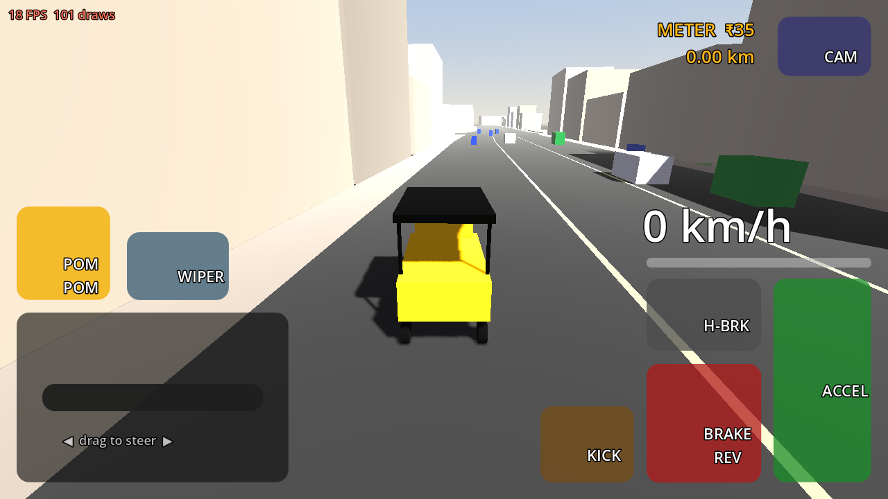

# 🛺 Namma Auto: Chennai Rickshaw Simulator 3D

[](https://github.com/DavidRajPaul/Auto-Simulator-Game-GoDot/actions/workflows/android-build.yml)

A culturally authentic auto-rickshaw driving and economy simulator set in Chennai, built in **Godot 4.x** for budget Android phones. The project is developed mostly by AI coding agents (Claude Code, Codex, Cursor) working under the rules in [`AGENTS.md`](AGENTS.md).

> **Pitch:** Drive a yellow-and-black Bajaj RE through Marina Beach, Mylapore and Anna Salai. Haggle fares in Tanglish ("Meter Podu vs. Bargain"), squeeze through gaps between MTC buses, survive the Northeast Monsoon, and build your Auto Stand reputation. Free Roam and Savari (passenger) mode are open from minute one, with no parking-gate grind.

---

## 📌 At a glance

| | |
|---|---|
| **Genre** | Open-zone driving + economy sim (hybrid-casual / mid-core) |
| **Platform** | **Android only** (Google Play), arm64-v8a + armeabi-v7a |
| **Engine** | Godot 4.4.1 (pinned), Mobile renderer + GLES3 fallback, Jolt Physics 3D |
| **Language** | Fully statically typed GDScript 2.0 |
| **Target device** | Helio G85 / Snapdragon 680, 3–4 GB RAM, 60 FPS |
| **Size budget** | < 85 MB initial `.aab` |
| **Monetization** | Hybrid: rewarded + capped interstitial ads, Play Billing IAP (UPI) |

### Design pillars
1. **Madras Soul** – real Chennai landmarks, signage, sounds, vehicles and Tanglish dialogue.
2. **Immediate freedom** – Free Roam and Savari mode unlocked at install.
3. **Meter vs. Bargain** – 5-second fare haggling, fuel/LPG/EV management, Auto Stand respect.
4. **AI-agent modularity** – `SignalBus` decoupling, data in `.tres` resources, headless CLI tests.

---

## 🧱 Tech stack

| Layer | Choice |
|---|---|
| Engine / physics | Godot 4.x + Jolt, custom 3-point raycast delta-trike (based on `DAShoe1/Godot-Easy-Vehicle-Physics`) |
| Roads & traffic lanes | `TheDuckCow/godot-road-generator` |
| Map pipeline | OpenStreetMap → Blosm (Blender) / Python → chunked `.tscn` (250 m × 250 m, 3×3 streaming) |
| Agent tooling | `satelliteoflove/godot-mcp`, `Coding-Solo/godot-mcp` |
| Ads | AppLovin MAX or CAS.AI mediation + AdMob (`godot-sdk-integrations/godot-admob`) |
| IAP | Google Play Billing v7/v8 (`godot-google-play-billing`) – UPI via Play checkout |
| Save / social | Encrypted local save + Play Games Services v2; Nakama later |
| Assets | CC0/CC-BY only: Kenney, Quaternius, ambientCG, Poly Haven, Sonniss |

---

## 📂 Repository layout

```text
.
├── AGENTS.md                         # Agent constitution – read before every task
├── project.godot                     # Config, InputMap, autoloads, Jolt, 60 Hz physics
├── export_presets.cfg                # Android preset (arm64 + armv7)
├── .github/workflows/android-build.yml   # CI: tests → Android APK
├── autoloads/        SignalBus.gd, GameState.gd
├── data/vehicles/    VehicleStats.gd, Bajaj_RE_4S.tres, Madras_King_Deluxe.tres, Namma_Green_EV.tres
├── data/passengers/  PassengerArchetype.gd
├── scenes/           main_chennai.tscn (game), main_phase1_greybox.tscn (physics test arena), vehicles/, traffic/, ui/
├── scripts/vehicle/  AutoRickshawController.gd, CameraRig.gd, VehicleAudio.gd, AutoRickshawModel.gd, WheelModel.gd, MeshKit.gd
├── scripts/traffic/  ChennaiTrafficManager.gd, TrafficVehicleAI.gd
├── scripts/world/    WorldChunkStreamer.gd, RoadGraph.gd, ServicePoints.gd, WaterlogZone.gd, GreyboxDressing.gd
├── data/world/       OSM-built Chennai map: manifest, road graph, areas, 95 chunk files
├── data/osm/         raw Overpass extract (gz), © OpenStreetMap contributors
├── tools/osm/        fetch_osm.py, build_world.py, preview_map.py, config.py (zones, landmarks, stands)
├── scripts/ui/       TouchHUD.gd, PassengerHUD.gd, MiniMap.gd, GarageUI.gd, DebugOverlay.gd
├── scripts/passengers/ SavariManager.gd (ride loop), FareCalculator.gd, RouteLine.gd
├── assets/fonts/     Noto Sans Tamil (OFL)
├── translations/     ui.csv (English / Tamil)
├── data/passengers/  5 rider archetypes (.tres)
└── tests/            run_phase1_tests (50), phase2 (30), phase3 (41), phase4 (51), run_perf_probe
```

### Phase 1 controls (greybox)
| Action | Touch | Keyboard (editor testing) |
|---|---|---|
| Accelerate / Brake–reverse | right pedals | W/↑ · S/↓ |
| Steer | drag the handlebar zone (bottom-left) | A/← · D/→ |
| Handbrake | H-BRK | Space |
| Horn ("Pom-Pom") | POM POM | H |
| Kick-start after flooding | KICK | K |
| Camera (Chase → Cockpit → Top-down) | CAM | C |
| Wiper | WIPER | V |

The game starts at the **Mylapore Tank auto stand** in the OSM-built city. Yellow beams are riders waving you down: stop beside one, pick an offer within 5 seconds, then follow the green route.



The Phase 1 greybox strip (`scenes/main_phase1_greybox.tscn`) is kept as the physics test arena. It has a speed breaker at 180 m and a monsoon puddle (right side) at 320 m: stop in the puddle and the engine floods; tap KICK three times to restart.

---

## 🚀 Getting started

```bash
git clone https://github.com/DavidRajPaul/Auto-Simulator-Game-GoDot.git
cd Auto-Simulator-Game-GoDot

godot --headless --path . --import                                          # import assets
godot --headless --path . --fixed-fps 60 res://tests/run_phase1_tests.tscn  # run tests (exit 0 = pass)
```

Open the folder in **Godot 4.4.1** to play the greybox in the editor (keyboard controls above).

## 📦 Android builds (GitHub Actions)

Every push and PR to `main` runs **[Android Build](.github/workflows/android-build.yml)**:

1. **Tests + perf budget:** import, boot the main scene, run the Phase 1–4 suites, then drive both the city and the greybox under a virtual display and fail if draw calls exceed 150. Results appear in the run summary.
2. **Export:** Godot 4.4.1 + export templates (cached) + JDK 17 + the runner's Android SDK → `NammaAuto-debug.apk` (arm64-v8a + armeabi-v7a). The version code is the CI run number.
3. **Download:** Actions → latest run → *Artifacts* → `NammaAuto-android-<run>`. Install with `adb install -r NammaAuto-debug.apk` or sideload.
4. **Release APK (optional):** add repo secrets `ANDROID_KEYSTORE_BASE64`, `ANDROID_KEY_ALIAS` and `ANDROID_KEYSTORE_PASSWORD`, and CI also signs `NammaAuto-release.apk`.
5. **Tags:** pushing a tag like `v0.1.0` attaches the APKs to a GitHub Release.

> Play Store uploads need an **AAB** built through Godot's Gradle build. That is scheduled for Phase 6 (see priorities).

---

# 🗺️ Roadmap

The work is split into **MVP phases (1–5)**, which end in a feature-complete, closed-testable build, and **launch phases (6–10)**, which take that build through Google Play and into LiveOps. Every phase has an exit gate; an agent cannot start the next phase until the gate passes in CI.

Legend: ✅ done · 🟡 partly done · ⬜ not started · **Android only**: no iOS, desktop or web targets.

## Part A — MVP

### Phase 1 · Core greybox & 3-wheel physics 🟡 code ✅, device gate pending *(Weeks 1–2)*
**Goal:** the auto feels right to drive on a test strip, on a real budget phone.

| Item | Status |
|---|---|
| `AGENTS.md`, `project.godot` (InputMap, autoloads, Jolt, 60 Hz physics, strict typing) | ✅ |
| `SignalBus.gd`, `GameState.gd` (meter fare ₹35 + ₹18/km, night 1.5×) | ✅ |
| `VehicleStats.gd` + `Bajaj_RE_4S.tres`, `PassengerArchetype.gd` | ✅ |
| `AutoRickshawController.gd`: 3-ray suspension, anti-roll, two-wheel Gethu, water stall + kick-start, passenger mass/CoM, LPG burn, odometer | ✅ |
| `CameraRig.gd`: Chase, Cockpit, Top-down | ✅ |
| `ChennaiTrafficManager.gd` + `TrafficVehicleAI.gd`: 18-vehicle pool, 6 sub-lanes, gap-seeking, horn tiers (buses ignore twin horn) | ✅ |
| `TouchHUD.gd`: multitouch handlebar, pedals, horn, kick, camera, wiper, speedo, fare meter, LPG bar | ✅ |
| Greybox Anna Salai strip: speed breaker, monsoon puddle, MultiMesh buildings | ✅ |
| Feel tuning: torque curve + aero drag (0–35 km/h 2.8 s, 0–45 km/h 4.2 s, 58 km/h top), 2.1 m U-turn radius, brief Gethu tilt in hard turns | ✅ |
| Placeholder audio (`VehicleAudio.gd`): synthesised 4-stroke putter pitched by speed, "pom-pom" bulb horn, kick-start clunk, no asset files | ✅ |
| Debug overlay (`DebugOverlay.gd`): FPS, worst FPS, draw calls, physics ms, RAM; debug APK only, tap to cycle | ✅ |
| `tests/run_phase1_tests.tscn`: 46 automated checks | ✅ |
| `tests/run_perf_probe.tscn`: draw-call / traffic budget gate on every push (currently 99 / 150 draw calls) | ✅ |
| GitHub Actions: tests → perf probe → Android debug APK (+ signed release when secrets exist) | ✅ |
| On-device tuning & 60 FPS on Helio G85 / SD680 | ⬜ **needs you + a phone** |

**Exit gate:** headless tests pass; throttle 4 s → ≥ 35 km/h; full steer at 30 km/h keeps roll < 22°; horn shifts AI within 18 m; steady 60 FPS on the budget test device.

### Phase 2 · Chennai world: 3 zones 🟡 code ✅, device gate pending *(Weeks 3–4)*
**Goal:** a dense ~2.5 km connected map that is recognisably Chennai.


| Item | Status |
|---|---|
| OSM pipeline: `tools/osm/fetch_osm.py` (Overpass, run by the **OSM Import** workflow) → `build_world.py` → `data/world/` (1.2 MB) | ✅ |
| Real roads for Marina, Mylapore, Anna Salai → T. Nagar: 3,105 road segments, 2,360 junctions, fully connected, at 1 : 2.5 scale (2.7 × 2.4 km) with real road widths | ✅ |
| 3,515 procedural frontage buildings styled per zone (heritage Mylapore, commercial T. Nagar, taller Anna Salai), with colliders | ✅ |
| Sea, beach, temple tank, Buckingham Canal/Adyar water, parks from OSM polygons | ✅ |
| Landmark placeholders at real positions: Marina Lighthouse, Napier Bridge, Vivekananda House, Kapaleeshwarar gopuram, temple tank, LIC Building, Gemini Flyover, Panagal Park | ✅ |
| `WorldChunkStreamer.gd`: 250 m chunks, 3×3 around the player, built on worker threads (~2 draw calls per chunk) | ✅ |
| `RoadGraph.gd` + traffic rewrite: AI drives on the **left**, 3 sub-lanes per lane, turns at junctions, faces travel direction | ✅ |
| Stray cattle in Mylapore / T. Nagar market zones (ignore the twin horn) | ✅ |
| 3 auto stands (Mylapore Tank, Marina Lighthouse, Panagal Park); game now starts at Mylapore | ✅ |
| `tests/run_phase2_tests.tscn` (30 checks) + perf probe on the city: 112 / 150 draw calls, 80 MB | ✅ |
| Jaywalking pedestrians in market zones | ⬜ |
| Gemini Flyover / Napier Bridge as real elevated ramps (currently decks over the road) | ⬜ |
| Shopfront & signage texture atlases (Tamil/English boards) | ⬜ → with Phase 5 art |
| 60 FPS / RAM check driving all three zones on the budget phone | ⬜ **needs you + a phone** |

**Changes from the original plan** (each simplifies the AI-agent workflow):
- Our own ribbon road builder instead of `godot-road-generator`: chunk data stays plain JSON that agents can diff and regenerate, with no editor plugin.
- Chunks are JSON built into meshes at runtime on worker threads, not baked `.tscn` files. That keeps the repo small (1.2 MB for the whole map) and rebuilds are deterministic.
- Buildings are generated along road frontage rather than taken from OSM footprints. Chennai's OSM building coverage is patchy, and footprints overlap after the 1 : 2.5 compression.
- Map is 1 : 2.5 scale (tech spec says "compressed"), so Marina → T. Nagar is ~2.2 km of driving instead of ~5.5 km.

**Exit gate:** drive all three zones without hitches; ≤ 150 draw calls; RAM < 400 MB; 60 FPS on device.

### Phase 3 · Core loop: Savari & "Meter vs. Bargain" ✅ code complete *(Weeks 4–5)*
**Goal:** the money-making loop works end to end.

| Haggle card | Ride with GPS |
|---|---|
|  |  |

| Item | Status |
|---|---|
| 5 passenger archetypes as `.tres`: IT commuter, T. Nagar silk shopper (+45 kg bags), Marina tourist, monsoon rider (1.5× surge), college student (pays for near misses) — each with Tanglish lines | ✅ |
| Hails at the 3 auto stands and roadside kerbs, weighted by home zone; pooled hail markers | ✅ |
| 5-second haggle card: Correct Meter (100%) / Meter Mela +₹30 (65–85%) / Fixed ₹200 (25–40%); no answer = rider walks off; rejection = −Respect + 10 s lost | ✅ |
| `FareCalculator`: Chennai meter (₹35 + ₹18/km on real-equivalent km), quotes, odds (rain & Alangaram modifiers), tips, stars | ✅ |
| GPS: A* on the road graph respecting one-ways, auto re-route when you go off-route, green route painted on the road | ✅ |
| Heading-up circular mini-map with roads, route, hails, destination | ✅ |
| Comfort tea-cup: lateral g vs rider tolerance, hard braking, speed-breaker jolts, crashes | ✅ |
| Gap-la Gethu near-miss detection (< 0.6 m at > 35 km/h) + bonus from college students | ✅ |
| Ride timer, fare breakdown (fare + comfort tip + Gethu bonus), Respect XP, rolling star rating, wallet | ✅ |
| Meter flag shows FOR HIRE / hired fare | ✅ |
| `tests/run_phase3_tests.tscn`: 41 checks incl. full rides end-to-end | ✅ |
| Namma-Yatri-style dashboard app dispatch | ⬜ → Phase 10 (GDD: unlocks at Level 3) |
| 2× fare rewarded video on the fare screen | ⬜ → Phase 6 |

**Map fix found here:** one-way streets clipped at the map edge created trap junctions you could enter but not leave (108 junctions). The converter now opens those one-ways both ways, so every road is reachable.

**Exit gate:** 30-minute session of continuous rides with no crash **(you, on device)**; fare maths covered by tests ✅.

### Phase 4 · Economy, garage & vehicles ✅ code complete *(Week 5)*
**Goal:** progression from the starter auto to the second auto.

| Singara Classic | Madras King Deluxe (Black-Gold paint) | Namma Green EV |
|---|---|---|
|  |  |  |

| Garage | Settings in Tamil |
|---|---|
|  |  |

| Item | Status |
|---|---|
| **Procedural Bajaj RE model** (tapered snout & headlamp, canvas hood, windscreen, chrome bumper/rails, maroon bench, handlebar, mirrors, meter box, mudguards): 2.4k tris incl. wheels, 6 draw calls; paint follows the garage | ✅ |
| 3 autos as `.tres`: Singara Classic (starter, bulb horn), Madras King Deluxe (₹1,500, 72 km/h, half pothole discomfort, twin air-horn), Namma Green EV (₹4,500, instant torque, silent, +25% green tip) | ✅ |
| Garage at each auto stand ("Puncture & Tinkering"): Repair (₹3/%), Upgrades (engine/suspension/tyres ×3 levels), Horns (bulb → twin → musical air-horn, changes which traffic gives way), Paint/Alangaram (better Meter Mela odds), Autos (buy/switch, live swap) | ✅ |
| LPG drain per km, 4 LPG bunks (₹62/L) and 3 EV kiosks (₹12/kWh) on the map, wrong-fuel warning, ₹150 tow when you run dry | ✅ |
| Condition: crashes wear the auto; below 40% it loses speed | ✅ |
| Shift clock 6 AM → 10 PM in 12 real minutes, end-of-day summary, next day | ✅ |
| Encrypted save (`user://savegame.dat`, device-bound key + checksum; tampered saves rejected), autosave after rides/purchases/every 60 s/app pause | ✅ |
| Settings: controls (handlebar drag / arrow buttons / tilt), graphics Low/Medium/High (shadows, 3D resolution), **English / தமிழ்** with bundled Noto Sans Tamil, volume | ✅ |
| `tests/run_phase4_tests.tscn`: 51 checks incl. economy simulation | ✅ |
| Tilt steering on a real phone (sensor axis) | ⬜ **needs you + a phone** |

**Economy note:** the GDD prices the King Deluxe at ₹15,000 but also wants it unlockable in ~30 minutes. Realistic Chennai meter fares earn ~₹70–150 per ride, so the price is ₹1,500 in `Madras_King_Deluxe.tres`. The test simulates ~14 rides (≈30 min) to afford it. Raise the price if the 8-rewarded-videos route (Phase 6) should be the main path.

**Exit gate:** a new player can earn and unlock Madras King Deluxe in ~30 min ✅ (simulated); save/load survives app kill ✅ (autosave on pause/close; **(you)** confirm on device).

### Phase 5 · Polish: weather, audio, UX → **MVP complete** *(Week 6)*
**Goal:** a build good enough to put in front of testers.
- Day/night cycle (Agni Nakshatram noon, Marina sunset, neon night) with headlights.
- Northeast Monsoon: rain shader, working wiper, waterlogged puddles, kick-start rhythm mini-game.
- **Audio** (GDD Phase 3 · Assets Catalog §6; Phase 1 shipped synthesised placeholders):
  - Engine loops per vehicle, pitch-shifted by RPM: 2-stroke "Singara Classic" phat-phat, 4-stroke LPG "Madras King Deluxe", EV whine for "Namma Green EV" (CC0: Sonniss GDC archive / Kenney, mono `.ogg` 96 kbps).
  - 5 horns matching the gameplay tiers: bulb pom-pom, twin electric, musical air-horn, plus 2 unlockable/cosmetic horns (64 kbps `.ogg`).
  - Monsoon rain loop, wiper squeak, puddle splash, kick-start lever, stall sputter.
  - Tamil street ambience by zone (Marina sea breeze & vendors, Mylapore temple bells, T. Nagar crowd/traffic), AI traffic horns honking back.
  - UI SFX: meter tick, coin/rupee chime, haggle accept/reject, fare summary.
  - Audio buses (Engine / SFX / Ambience / UI) with volume sliders in Settings; ≤ 5 MB total audio in the APK.
- First-launch onboarding (no forced parking tutorial), main menu, pause, credits/attributions.
- Performance pass on the budget device; size pass.

**MVP exit gate:** feature-complete loop; `.aab` < 85 MB; 60 FPS sustained 20 min without thermal drop below 45 FPS; zero known crashers.

---

## Part B — Play Store launch & beyond

### Phase 6 · Monetization & platform services *(Week 7)*
- `AdMonetizationManager.gd`: mediation (AppLovin MAX or CAS.AI + AdMob), rewarded 2× fare / fuel rescue / test-drive, interstitials capped (8-minute first-session grace, ≥ 180 s apart, ≤ 2 per 10 min, never blocking), native 3D billboards on Anna Salai/Usman Road.
- UMP consent (GDPR / India DPDP).
- Play Billing: `no_ads_forever` (₹99–149), `starter_pack_chennai` (₹29–49), garage bundle, zone unlocks, Madras Monsoon Pass (₹149/mo).
- Play Games Services v2: cloud save, achievements, leaderboards.
- Firebase Analytics, Crashlytics, Remote Config (ad caps and prices remote-tunable).

**Exit gate:** test ads fill in sandbox; UPI license-test purchase succeeds; ANR rate 0 % in internal testing.

### Phase 7 · Compliance & store readiness *(Week 7–8)*
- Target API level current for Play, 64-bit, signed `.aab`, Play App Signing.
- Data Safety form, privacy policy page, IARC rating, `app-ads.txt` on developer domain.
- Store listing in English + Tamil: icon, feature graphic, screenshots, 30-s trailer.
- Licence audit of every asset and plugin (CC0/CC-BY/MIT/Apache only) and credits screen.

**Exit gate:** listing and policy declarations approved for testing tracks.

### Phase 8 · Closed testing (Google Play 14-day rule) *(Weeks 8–10)*
- Internal track → Closed track with ≥ 12 opted-in testers for 14 continuous days (required for new personal developer accounts).
- Device matrix: Redmi, Realme, Samsung M/A series, at least one 3 GB device.
- Collect feedback in-app; fix-release weekly.

**Exit gate:** crash-free sessions ≥ 99.2 %; production access granted.

### Phase 9 · Soft launch & production release *(Weeks 10–12)*
- Soft launch in India, UAE, Singapore, Malaysia (diaspora eCPMs).
- Track D1 (target ≥ 32–35 %), D7, D30 (target ≥ 6 %), ARPDAU (target ~$0.015), session length.
- A/B test icons and store screenshots; tune haggling and ad caps via Remote Config.
- Staged rollout to production (10 % → 50 % → 100 %).

**Exit gate:** retention and crash targets met; 100 % rollout.

### Phase 10 · LiveOps & content updates *(Month 3+)*
- **1.1** – MGR Central, Kathipara cloverleaf, OMR IT corridor zones; Namma-Yatri-style dashboard app dispatch.
- **1.2** – 7-seater Share Auto mode (multiple passengers on a fixed route); traffic police challans.
- **1.3** – Madras Sticker & Livery Studio with custom `.png` import; weekly Auto Stand leaderboards (Nakama / Play Games).
- Seasonal events (Pongal, Deepavali, Monsoon Pass seasons); ASO for "auto rickshaw game", "Chennai game".

---

## 🎯 Remaining work to MVP

Agent work is everything not marked **(you)**.

**Phase 1–2 close-out**
1. **(you)** Install the latest CI APK (`NammaAuto-android-<run>`) on a Helio G85 / SD680-class phone. It now starts at the Mylapore auto stand. Tap the top-left readout for full stats and drive Mylapore → Marina → Anna Salai for ~10 minutes. Report FPS / worst FPS, RAM, any hitches when new areas load, and anything that feels wrong.
2. Jaywalkers in market zones, reusing the cattle spawning path.
3. Gemini Flyover and Napier Bridge as real elevated ramps (needs ramp collision; the rest of the map is flat).

**Phase 3–4 – Core loop, economy & garage** ✅ done in code
4. **(you)** Play a full in-game day (12 real minutes) on the phone. Check: haggle readability, fares/tips, comfort fairness, fuel lasting ~15–20 rides, whether ₹1,500 for the King Deluxe feels right, and **tilt steering** (sensor axis/sign).
5. Balance pass from your notes (numbers live in `data/passengers/*.tres`, `data/vehicles/*.tres`, `FareCalculator.gd`, `GameState.UPGRADES/HORNS/PAINTS`).

**Phase 5 – Polish → MVP** (next)
6. Day/night tied to the shift clock (noon glare → Marina sunset → neon night) and headlights; monsoon rain shader, working wiper, kick-start rhythm mini-game.
7. Real audio replacing the placeholders (full list under Phase 5).
8. Traffic/cattle/landmark models (the player auto is now modelled) and shopfront/signage texture atlases.
9. Main menu, onboarding, credits incl. OpenStreetMap (ODbL) attribution.
10. AAB via Gradle build in CI, size check < 85 MB.
11. **(you)** 20-minute thermal soak on the budget phone.

**Start early, in parallel (you):** Google Play developer account and app entry, upload keystore (→ `ANDROID_KEYSTORE_*` repo secrets), 12+ closed testers.

---

## ✅ Verification loop (every task)

1. `godot --headless --path . --import` then `--quit-after 120`: no `SCRIPT ERROR`.
   Map data changed? Re-run **Actions → OSM Import** (or `python3 tools/osm/build_world.py` if only the converter changed) and commit `data/world/`.
2. `godot --headless --path . --fixed-fps 60 res://tests/run_phaseN_tests.tscn`: exit code 0.
3. Perf probe (needs a display, e.g. `xvfb-run`): `godot --path . --rendering-method gl_compatibility --fixed-fps 60 res://tests/run_perf_probe.tscn`: exit code 0.
4. **Android Build** workflow green on the PR.
5. MCP playtest when Godot MCP is connected (see `AGENTS.md` §4).

## 📏 Rules for contributors and agents

See [`AGENTS.md`](AGENTS.md). In short: communicate only through `SignalBus`, type everything, keep tunables in `.tres`, never fake 4-wheel physics, never `instantiate()`/`queue_free()` while driving, respect the 150-draw-call and 18-vehicle budgets, and don't hand-write `uid://` values.

## 🗺️ Map data

Roads, coastline, water and parks come from **OpenStreetMap** (© OpenStreetMap contributors, ODbL) via `tools/osm`. Zones, landmarks and auto stands are configured in `tools/osm/config.py`. Change them, run **Actions → OSM Import**, then pull.

## 📜 Licence & credits

Code licence: TBD. Fonts: Noto Sans Tamil © The Noto Project Authors, SIL Open Font License 1.1 (`assets/fonts/OFL.txt`). Third-party assets and plugins are listed with their licences in the in-game Credits screen. OpenStreetMap data © OpenStreetMap contributors (ODbL).
