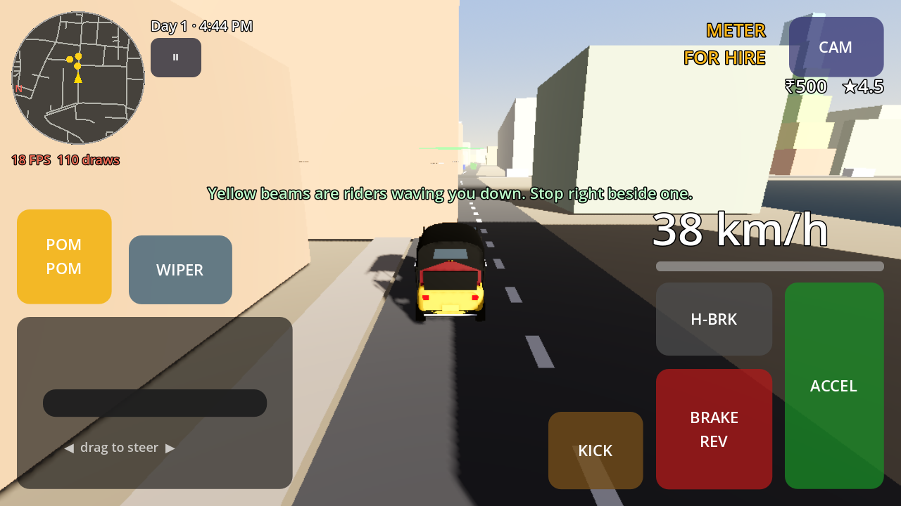
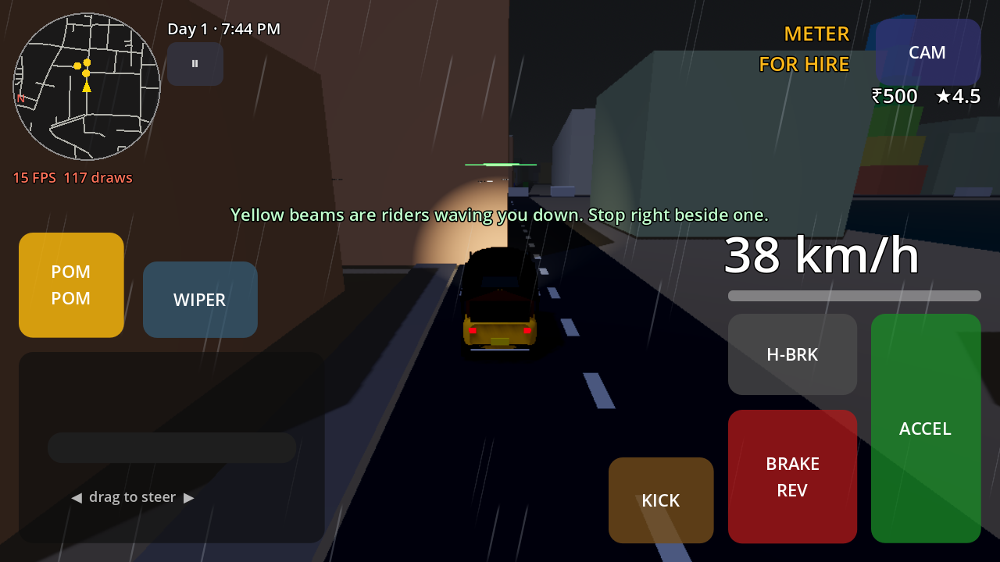
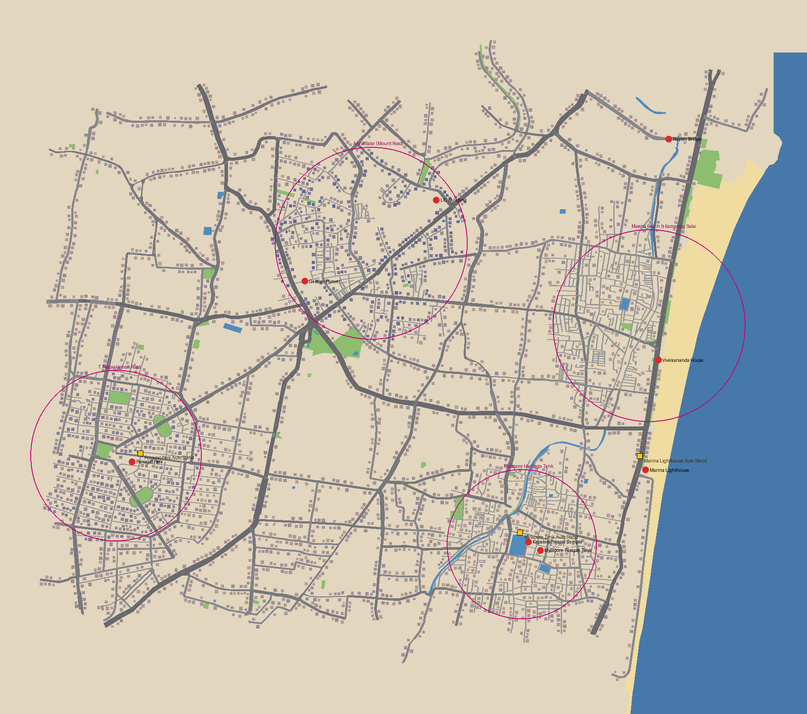
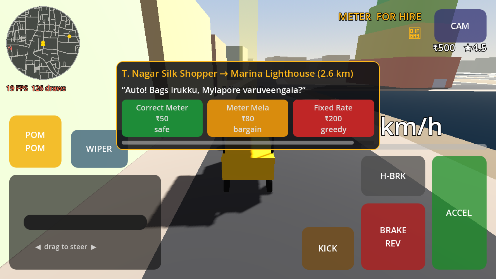
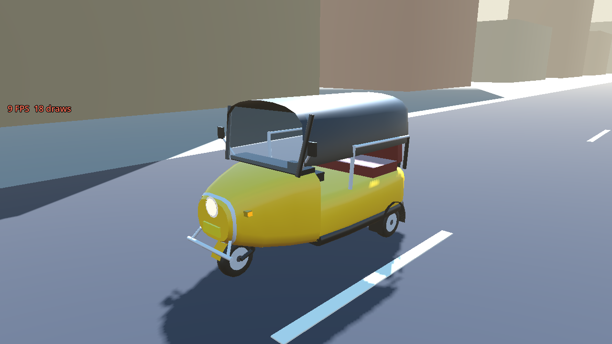

# 🛺 Namma Auto: Chennai Rickshaw Simulator 3D

[](https://github.com/DavidRajPaul/Auto-Simulator-Game-GoDot/actions/workflows/android-build.yml)

A culturally authentic auto-rickshaw driving and economy simulator set in Chennai, built in **Godot 4.x** for budget Android phones. The project is developed mostly by AI coding agents (Claude Code, Codex, Cursor) working under the rules in [`AGENTS.md`](AGENTS.md).

> **Pitch:** Drive a yellow-and-black Bajaj RE through Marina Beach, Mylapore and Anna Salai. Haggle fares in Tanglish ("Meter Podu vs. Bargain"), squeeze through gaps between MTC buses, survive the Northeast Monsoon, and build your Auto Stand reputation. Free Roam and Savari (passenger) mode are open from minute one, with no parking-gate grind.

---

## 📌 At a glance

| | |
|---|---|
| **Genre** | Open-zone driving + economy sim (hybrid-casual / mid-core) |
| **Platform** | **Android only** (Google Play), arm64-v8a + armeabi-v7a |
| **Engine** | Godot 4.4.1 (pinned), Mobile renderer + GLES3 fallback, Jolt Physics 3D |
| **Language** | Fully statically typed GDScript 2.0 |
| **Target device** | Helio G85 / Snapdragon 680, 3–4 GB RAM, 60 FPS |
| **Size budget** | < 85 MB initial `.aab` |
| **Monetization** | Hybrid: rewarded + capped interstitial ads, Play Billing IAP (UPI) |

### Design pillars
1. **Madras Soul** – real Chennai landmarks, signage, sounds, vehicles and Tanglish dialogue.
2. **Immediate freedom** – Free Roam and Savari mode unlocked at install.
3. **Meter vs. Bargain** – 5-second fare haggling, fuel/LPG/EV management, Auto Stand respect.
4. **AI-agent modularity** – `SignalBus` decoupling, data in `.tres` resources, headless CLI tests.

---

## 🧱 Tech stack

| Layer | Choice |
|---|---|
| Engine / physics | Godot 4.x + Jolt, custom 3-point raycast delta-trike (based on `DAShoe1/Godot-Easy-Vehicle-Physics`) |
| Roads & traffic lanes | [`a-b-street/osm2streets`](https://github.com/a-b-street/osm2streets) (Apache-2.0): real lane, sidewalk, junction and marking polygons from OSM, left-hand driving |
| Map pipeline | OpenStreetMap (Overpass) → osm2streets + `tools/osm/build_world.py` → pre-triangulated JSON chunks (250 m × 250 m, 3×3 streaming), **real size (1 : 1)** with 21.6k real building footprints |
| Agent tooling | `satelliteoflove/godot-mcp`, `Coding-Solo/godot-mcp` |
| Ads | AppLovin MAX or CAS.AI mediation + AdMob (`godot-sdk-integrations/godot-admob`) |
| IAP | Google Play Billing v7/v8 (`godot-google-play-billing`) – UPI via Play checkout |
| Save / social | Encrypted local save + Play Games Services v2; Nakama later |
| Assets | CC0/CC-BY only: Kenney, Quaternius, ambientCG, Poly Haven, Sonniss |

---

## 📂 Repository layout

```text
.
├── AGENTS.md                         # Agent constitution – read before every task
├── project.godot                     # Config, InputMap, autoloads, Jolt, 60 Hz physics
├── export_presets.cfg                # Android presets: APK + Gradle App Bundle (arm64 + armv7)
├── .github/workflows/android-build.yml   # CI: tests → perf → Android APK + AAB
├── .github/workflows/osm-import.yml      # Overpass fetch → rebuild data/world
├── .github/workflows/osm-streets.yml     # builds osm2streets (Rust) → lane geometry → rebuild data/world
├── autoloads/        SignalBus.gd, GameState.gd
├── data/vehicles/    VehicleStats.gd, Bajaj_RE_4S.tres, Madras_King_Deluxe.tres, Namma_Green_EV.tres
├── data/passengers/  PassengerArchetype.gd
├── scenes/           main_menu.tscn (start), main_chennai.tscn (game), main_phase1_greybox.tscn (physics test arena), vehicles/, traffic/, ui/
├── scripts/vehicle/  AutoRickshawController.gd, CameraRig.gd, VehicleAudio.gd, AutoRickshawModel.gd, WheelModel.gd, MeshKit.gd, ComfortAssist.gd
├── scripts/traffic/  ChennaiTrafficManager.gd, TrafficVehicleAI.gd
├── scripts/world/    WorldChunkStreamer.gd, RoadGraph.gd, ServicePoints.gd, Atmosphere.gd, MonsoonFX.gd, WaterlogZone.gd, GreyboxDressing.gd
├── shaders/          rain_overlay.gdshader (rain streaks, windscreen drops, wiper)
├── data/world/       OSM-built Chennai map (1 : 1): manifest, road graph, areas, 513 chunk files (~20 MB, ~6 MB zipped)
├── data/osm/         raw Overpass extract + osm2streets output (gz), © OpenStreetMap contributors
├── tools/osm/        fetch_osm.py, run_osm2streets.py, build_world.py, streets.py, preview_map.py, config.py (zones, landmarks, stands, services, flood spots)
├── scripts/ui/       MainMenu.gd, TouchHUD.gd, PassengerHUD.gd, MiniMap.gd, GarageUI.gd, DebugOverlay.gd
├── scripts/passengers/ SavariManager.gd (ride loop), FareCalculator.gd, RouteLine.gd
├── assets/fonts/     Noto Sans Tamil (OFL)
├── translations/     ui.csv (English / Tamil)
├── data/passengers/  5 rider archetypes (.tres)
├── scripts/progression/ DriverProgress.gd (driver levels, shift goals)
├── assets/textures/  facade_atlas.png + facade_glow.png (tools/art/make_facade_atlas.py)
├── assets/ui/        controls_atlas.png (tools/art/make_ui_icons.py)
├── assets/audio/     ui/ (Kenney), ambience/ + traffic/ (BigSoundBank, Fetch Assets workflow)
├── assets_src/incoming/  downloads waiting to be integrated (not imported, not exported)
└── tests/            run_phase1_tests (50), phase2 (32), phase3 (45), phase4 (51), phase5 (35), phase6 (66), phase7 UI (22), phase8 play-test (55), phase9 city & people (35), run_perf_probe
```

### Controls
| Action | Touch | Keyboard (editor testing) |
|---|---|---|
| Accelerate / Brake | right pedals | W/↑ · S/↓ |
| Gear D ↔ R (stop first) | D/R button above the brake | R |
| Indicators left / right (self-cancel after the turn) | arrow buttons above the steering | Q · E |
| Steer | drag the handlebar zone (bottom-left) | A/← · D/→ |
| Handbrake | H-BRK | Space |
| Horn ("Pom-Pom") | POM POM | H |
| Kick-start after flooding (button appears only then) | KICK | K |
| Camera (Chase → Cockpit → Top-down) | CAM | C |
| Wiper (button appears in rain) | WIPER | V |

With **Brake to reverse** on (default, in Settings), holding BRAKE at a stop also engages R; then BRAKE drives backwards and ACCEL stops you and returns to D.

The game opens on the **main menu** (Continue / New career / Settings / Credits), then drops you at the **Mylapore Tank auto stand** in real-size Chennai. A first-run hint line walks you through one ride: drive off, stop beside a yellow beam (a rider waving you down), pick an offer within 5 seconds, then follow the green route and the green arrow above your auto. The Android back button pauses; back again resumes.

| Main menu | Mylapore at 1 : 1 (real OSM buildings, osm2streets lanes) | Monsoon night |
|---|---|---|
|  |  |  |


The Phase 1 greybox strip (`scenes/main_phase1_greybox.tscn`) is kept as the physics test arena. It has a speed breaker at 180 m and a monsoon puddle (right side) at 320 m: stop in the puddle and the engine floods; tap KICK three times to restart.

---

## 🚀 Getting started

```bash
git clone https://github.com/DavidRajPaul/Auto-Simulator-Game-GoDot.git
cd Auto-Simulator-Game-GoDot

godot --headless --path . --import                                          # import assets
godot --headless --path . --fixed-fps 60 res://tests/run_phase1_tests.tscn  # run tests (exit 0 = pass)
```

Open the folder in **Godot 4.4.1** to play the greybox in the editor (keyboard controls above).

## 📦 Android builds (GitHub Actions)

Every push and PR to `main` runs **[Android Build](.github/workflows/android-build.yml)**:

1. **Tests + perf budget:** import, boot the main scene, run the Phase 1–5 suites, then drive both the city and the greybox under a virtual display and fail if draw calls exceed 150. Results appear in the run summary.
2. **Export:** Godot 4.4.1 + export templates (cached) + JDK 17 + the runner's Android SDK → `NammaAuto-debug.apk` (arm64-v8a + armeabi-v7a), plus a **Gradle-built App Bundle** (`NammaAuto-debug.aab`, or `-release.aab` with the signing secrets) for Google Play. The version code is the CI run number.
3. **Download:** Actions → latest run → *Artifacts* → `NammaAuto-android-<run>`. Install with `adb install -r NammaAuto-debug.apk` or sideload.
4. **Release builds (optional):** add repo secrets `ANDROID_KEYSTORE_BASE64`, `ANDROID_KEY_ALIAS` and `ANDROID_KEYSTORE_PASSWORD`, and CI also signs `NammaAuto-release.apk` and `NammaAuto-release.aab` (the one you upload to Play).
5. **Tags:** pushing a tag like `v0.5.0` attaches the APK and AAB to a GitHub Release.

---

# 🗺️ Roadmap

The work is split into **MVP phases (1–5)**, which end in a feature-complete, closed-testable build, and **launch phases (6–10)**, which take that build through Google Play and into LiveOps. Every phase has an exit gate; an agent cannot start the next phase until the gate passes in CI.

Legend: ✅ done · 🟡 partly done · ⬜ not started · **Android only**: no iOS, desktop or web targets.

## Part A — MVP

### Phase 1 · Core greybox & 3-wheel physics 🟡 code ✅, device gate pending *(Weeks 1–2)*
**Goal:** the auto feels right to drive on a test strip, on a real budget phone.

| Item | Status |
|---|---|
| `AGENTS.md`, `project.godot` (InputMap, autoloads, Jolt, 60 Hz physics, strict typing) | ✅ |
| `SignalBus.gd`, `GameState.gd` (meter fare ₹35 + ₹18/km, night 1.5×) | ✅ |
| `VehicleStats.gd` + `Bajaj_RE_4S.tres`, `PassengerArchetype.gd` | ✅ |
| `AutoRickshawController.gd`: 3-ray suspension, anti-roll, two-wheel Gethu, water stall + kick-start, passenger mass/CoM, LPG burn, odometer | ✅ |
| `CameraRig.gd`: Chase, Cockpit, Top-down | ✅ |
| `ChennaiTrafficManager.gd` + `TrafficVehicleAI.gd`: 18-vehicle pool, 6 sub-lanes, gap-seeking, horn tiers (buses ignore twin horn) | ✅ |
| `TouchHUD.gd`: multitouch handlebar, pedals, horn, kick, camera, wiper, speedo, fare meter, LPG bar | ✅ |
| Greybox Anna Salai strip: speed breaker, monsoon puddle, MultiMesh buildings | ✅ |
| Feel tuning: torque curve + aero drag (0–35 km/h 2.8 s, 0–45 km/h 4.2 s, 58 km/h top), 2.1 m U-turn radius, brief Gethu tilt in hard turns | ✅ |
| Placeholder audio (`VehicleAudio.gd`): synthesised 4-stroke putter pitched by speed, "pom-pom" bulb horn, kick-start clunk, no asset files | ✅ |
| Debug overlay (`DebugOverlay.gd`): FPS, worst FPS, draw calls, physics ms, RAM; debug APK only, tap to cycle | ✅ |
| `tests/run_phase1_tests.tscn`: 46 automated checks | ✅ |
| `tests/run_perf_probe.tscn`: draw-call / traffic budget gate on every push (currently 99 / 150 draw calls) | ✅ |
| GitHub Actions: tests → perf probe → Android debug APK (+ signed release when secrets exist) | ✅ |
| On-device tuning & 60 FPS on Helio G85 / SD680 | ⬜ **needs you + a phone** |

**Exit gate:** headless tests pass; throttle 4 s → ≥ 35 km/h; full steer at 30 km/h keeps roll < 22°; horn shifts AI within 18 m; steady 60 FPS on the budget test device.

### Phase 2 · Chennai world: 3 zones 🟡 code ✅, device gate pending *(Weeks 3–4)*
**Goal:** a dense ~2.5 km connected map that is recognisably Chennai.



| Item | Status |
|---|---|
| OSM pipeline: `tools/osm/fetch_osm.py` (Overpass, run by the **OSM Import** workflow) → `build_world.py` → `data/world/` (1.2 MB) | ✅ |
| Real roads for Marina, Mylapore, Anna Salai → T. Nagar: 3,105 road segments, 2,360 junctions, fully connected, at 1 : 2.5 scale (2.7 × 2.4 km) with real road widths | ✅ |
| 3,515 procedural frontage buildings styled per zone (heritage Mylapore, commercial T. Nagar, taller Anna Salai), with colliders | ✅ |
| Sea, beach, temple tank, Buckingham Canal/Adyar water, parks from OSM polygons | ✅ |
| Landmark placeholders at real positions: Marina Lighthouse, Napier Bridge, Vivekananda House, Kapaleeshwarar gopuram, temple tank, LIC Building, Gemini Flyover, Panagal Park | ✅ |
| `WorldChunkStreamer.gd`: 250 m chunks, 3×3 around the player, built on worker threads (~2 draw calls per chunk) | ✅ |
| `RoadGraph.gd` + traffic rewrite: AI drives on the **left**, 3 sub-lanes per lane, turns at junctions, faces travel direction | ✅ |
| Stray cattle in Mylapore / T. Nagar market zones (ignore the twin horn) | ✅ |
| 3 auto stands (Mylapore Tank, Marina Lighthouse, Panagal Park); game now starts at Mylapore | ✅ |
| `tests/run_phase2_tests.tscn` (30 checks) + perf probe on the city: 112 / 150 draw calls, 80 MB | ✅ |
| Jaywalking pedestrians in market zones | ⬜ |
| Gemini Flyover / Napier Bridge as real elevated ramps (currently decks over the road) | ⬜ |
| Shopfront & signage texture atlases (Tamil/English boards) | ⬜ → with Phase 5 art |
| 60 FPS / RAM check driving all three zones on the budget phone | ⬜ **needs you + a phone** |

**Changes from the original plan** (each simplifies the AI-agent workflow):
- Our own ribbon road builder instead of `godot-road-generator`: chunk data stays plain JSON that agents can diff and regenerate, with no editor plugin.
- Chunks are JSON built into meshes at runtime on worker threads, not baked `.tscn` files. That keeps the repo small (1.2 MB for the whole map) and rebuilds are deterministic.
- Buildings are generated along road frontage rather than taken from OSM footprints. Chennai's OSM building coverage is patchy, and footprints overlap after the 1 : 2.5 compression.
- Map is 1 : 2.5 scale (tech spec says "compressed"), so Marina → T. Nagar is ~2.2 km of driving instead of ~5.5 km.

**Superseded in Phase 5:** the map is now **real size (1 : 1, 7.0 × 5.9 km)** with real lane geometry from osm2streets and 21,610 real OSM building footprints (plus procedural fill only where OSM has gaps). See Phase 5.

**Exit gate:** drive all three zones without hitches; ≤ 150 draw calls; RAM < 400 MB; 60 FPS on device.

### Phase 3 · Core loop: Savari & "Meter vs. Bargain" ✅ code complete *(Weeks 4–5)*
**Goal:** the money-making loop works end to end.

| Haggle card | Ride with GPS |
|---|---|
|  |  |

| Item | Status |
|---|---|
| 5 passenger archetypes as `.tres`: IT commuter, T. Nagar silk shopper (+45 kg bags), Marina tourist, monsoon rider (1.5× surge), college student (pays for near misses) — each with Tanglish lines | ✅ |
| Hails at the 3 auto stands and roadside kerbs, weighted by home zone; pooled hail markers | ✅ |
| 5-second haggle card: Correct Meter (100%) / Meter Mela +₹30 (65–85%) / Fixed ₹200 (25–40%); no answer = rider walks off; rejection = −Respect + 10 s lost | ✅ |
| `FareCalculator`: Chennai meter (₹35 + ₹18/km on real-equivalent km), quotes, odds (rain & Alangaram modifiers), tips, stars | ✅ |
| GPS: A* on the road graph respecting one-ways, auto re-route when you go off-route, green route painted on the road | ✅ |
| Heading-up circular mini-map with roads, route, hails, destination | ✅ |
| Comfort tea-cup: lateral g vs rider tolerance, hard braking, speed-breaker jolts, crashes | ✅ |
| Gap-la Gethu near-miss detection (< 0.6 m at > 35 km/h) + bonus from college students | ✅ |
| Ride timer, fare breakdown (fare + comfort tip + Gethu bonus), Respect XP, rolling star rating, wallet | ✅ |
| Meter flag shows FOR HIRE / hired fare | ✅ |
| `tests/run_phase3_tests.tscn`: 41 checks incl. full rides end-to-end | ✅ |
| Namma-Yatri-style dashboard app dispatch | ⬜ → Phase 10 (GDD: unlocks at Level 3) |
| 2× fare rewarded video on the fare screen | ⬜ → Phase 6 |

**Map fix found here:** one-way streets clipped at the map edge created trap junctions you could enter but not leave (108 junctions). The converter now opens those one-ways both ways, so every road is reachable.

**Exit gate:** 30-minute session of continuous rides with no crash **(you, on device)**; fare maths covered by tests ✅.

### Phase 4 · Economy, garage & vehicles ✅ code complete *(Week 5)*
**Goal:** progression from the starter auto to the second auto.

| Singara Classic | Madras King Deluxe (Black-Gold paint) | Namma Green EV |
|---|---|---|
|  |  |  |

| Garage | Settings in Tamil |
|---|---|
|  |  |

| Item | Status |
|---|---|
| **Procedural Bajaj RE model** (tapered snout & headlamp, canvas hood, windscreen, chrome bumper/rails, maroon bench, handlebar, mirrors, meter box, mudguards): 2.4k tris incl. wheels, 6 draw calls; paint follows the garage | ✅ |
| 3 autos as `.tres`: Singara Classic (starter, bulb horn), Madras King Deluxe (₹1,000, 72 km/h, half pothole discomfort, twin air-horn), Namma Green EV (₹3,000, instant torque, silent, +25% green tip) | ✅ |
| Garage at each auto stand ("Puncture & Tinkering"): Repair (₹3/%), Upgrades (engine/suspension/tyres ×3 levels), Horns (bulb → twin → musical air-horn, changes which traffic gives way), Paint/Alangaram (better Meter Mela odds), Autos (buy/switch, live swap) | ✅ |
| LPG drain per km, 4 LPG bunks (₹62/L) and 3 EV kiosks (₹12/kWh) on the map, wrong-fuel warning, ₹150 tow when you run dry | ✅ |
| Condition: crashes wear the auto; below 40% it loses speed | ✅ |
| Shift clock 6 AM → 10 PM in 18 real minutes (was 12 on the compressed map), end-of-day summary, next day | ✅ |
| Encrypted save (`user://savegame.dat`, device-bound key + checksum; tampered saves rejected), autosave after rides/purchases/every 60 s/app pause | ✅ |
| Settings: controls (handlebar drag / arrow buttons / tilt), graphics Low/Medium/High (shadows, 3D resolution), **English / தமிழ்** with bundled Noto Sans Tamil, volume | ✅ |
| `tests/run_phase4_tests.tscn`: 51 checks incl. economy simulation | ✅ |
| Tilt steering on a real phone (sensor axis) | ⬜ **needs you + a phone** |

**Economy note:** the GDD prices the King Deluxe at ₹15,000 but also wants it unlockable in ~30 minutes. On the real-size map a ride is 0.6–2.4 km straight-line (~2–5 minutes), and GDD meter rates (₹35 for 1.8 km + ₹18/km) earn ~₹50–110 with tips, so the price is ₹1,000 (EV ₹3,000). The test simulates ~8 rides (≈30 min) to afford it. Raise the price if the 8-rewarded-videos route (Phase 6) should be the main path.

**Exit gate:** a new player can earn and unlock Madras King Deluxe in ~30 min ✅ (simulated); save/load survives app kill ✅ (autosave on pause/close; **(you)** confirm on device).

### Phase 5 · Polish → **MVP** 🟡 code ✅ (audio/art + device gate pending) *(Week 6)*
**Goal:** a build good enough to put in front of testers.

| Map: Mylapore at 1 : 1 (osm2streets lanes, real footprints) | Whole map |
|---|---|
|  |  |

| Item | Status |
|---|---|
| **Real Chennai roads:** A/B Street's [osm2streets](https://github.com/a-b-street/osm2streets) built in CI (`osm-streets.yml`) turns OSM into lane, sidewalk, junction and marking polygons (left-hand driving). `build_world.py` triangulates them per chunk (13k lanes, 5.5k junctions, 21k sidewalk pieces, centre lines, lane separators) | ✅ |
| **Real size (1 : 1)** — 7.0 × 5.9 km, every residential street drivable; AI traffic uses osm2streets lane counts and widths so it follows the painted lanes | ✅ |
| **21,610 real OSM building footprints** extruded (levels/height tags, else inferred from footprint size and zone), shop-front bands on busy streets, flat roofs, one wall collider per chunk; 8.9k procedural boxes only where OSM has gaps | ✅ |
| **Comfort pack:** auto-recover when flipped, "Reset auto" when stuck, green guidance arrow (route or nearest rider), first-run hints, haptics, gentler steering curve, speed-based FOV, pause on app switch | ✅ |
| Day/night on the shift clock (noon glare → golden Marina evening → readable night), auto headlight at dusk and in rain | ✅ |
| Northeast Monsoon: rain streaks, windscreen drops + working wiper (cockpit), wet glossy roads, 5 real flood-prone spots (Usman Road, Luz, Royapettah, Santhome, Gemini) that fill only in rain and can stall you | ✅ |
| Kick-start rhythm: after a flood, kicks only count in a steady rhythm (mashing floods it) | ✅ |
| Main menu (Continue / New career / Settings / Credits with OSM ODbL, osm2streets, Godot, Jolt, Noto credits); pause → Main menu; Android back button | ✅ |
| CI: Gradle-built **App Bundle (.aab)** next to the APK | ✅ |
| **Controls:** real reverse gear (D/R), indicators with blinking lamps + relay tick that self-cancel after the turn (+2 Respect, traffic behind gives way), brake/reverse lamps, icon-based pedals/buttons, KICK and WIPER only when needed | ✅ |
| **Building skins:** Chennai facade atlas — grilled windows with sunshades, balconies, AC units, office glass, a shop with a Tamil/English board per ground-floor bay, temple *kaavi* stripes, Mylapore heritage shutters, terrace roofs with water tanks; windows and shops light up at night (one shader, no extra draw calls) | ✅ |
| **Driver levels + shift goals** (see "Levels" below) | ✅ |
| Audio: Kenney UI sounds; CC0 rain / Marina waves / market / honk-back from BigSoundBank via the **Fetch Assets** workflow; zone ambience | ✅ |
| `tests/run_phase6_tests.tscn`: 48 checks (gears, indicators, give-way, levels, goals, save, facades, sounds); perf probe 125 / 150 | ✅ |
| `tests/run_phase5_tests.tscn`: 35 checks; perf probe 120 / 150 draw calls in the city | ✅ |
| **Audio** replacing the synth placeholders (engine loops per auto, 5 horns, rain/wiper/splash/kick, zone ambience, UI SFX, audio buses; ≤ 5 MB) | ⬜ needs the assets you download |
| **Chennai city pass** (`tests/run_phase9_tests.tscn`, 35 checks): concrete sunshades on every floor, parapets, stair head-rooms with black Sintex tanks, AC units and shop awnings on every building; EB poles with sagging wires, neem trees and coconut palms on the kerbs (all merged into each chunk's one building mesh — no extra draw calls); TWAD water towers, canal-side settlements and Chennai Central on the northern skyline; procedural Marina lighthouse and Kapaleeshwarar-style gopuram | ✅ |
| **Chennai people:** 6 textured characters (veshti, two sarees, churidar, pavadai-davani, young man) on a clean 22-bone rig with a retargeted walk + idle (`tools/assets/process_people.py`); 14 walk the kerbs, turn at junctions, wait at the roadside and jump out of the way of a fast auto; walk pace and animation rate are locked together so feet don't slide | ✅ |
| **Traffic:** TNSTC town bus and SETC coach on the bus slot, Tamil Nadu goods lorry added; King Deluxe gets a diesel engine; a real Indian road ambience bed under the zone sounds | ✅ |
| Art pass: lane-arrow decals; animated hail riders | ⬜ |
| 60 FPS 20-minute thermal soak on the budget phone; AAB < 85 MB | ⬜ **needs you + a phone** (CI reports AAB size) |

#### Levels

There are no "level 1, level 2" stages: the whole city is open from minute one (GDD pillar 2, and gated free roam was the top complaint about rival games). Progression is:

* **Driver Level 1–20** from Driver XP: every ride gives 20 XP, plus up to 10 for comfort, 5 for on time, 3 for a Correct Meter fare and 2 per near miss; each signalled turn gives 2. Lv 2 comes after ~4 rides, Lv 5 after ~30, Lv 10 after ~150.
* Each level pays **₹50 × level** and a stand title (Puthu Driver → Stand Member → Meter Maestro → … → **Madras Legend**).
* A few unlocks, never core play: **Lv 4** Madras Musical Air-Horn, **Lv 5** Namma Green EV, **Lv 6** Neon Night paint, Lv 3 ride-app teaser (app dispatch is Phase 10). The King Deluxe is never gated.
* **3 shift goals per day** (e.g. "Complete 4 rides", "2 smooth rides", "Earn ₹300", "3 Correct Meter rides", "4 Gap-la Gethu", "Signal 5 turns"): ₹40 + 60 XP each, ₹100 for all three. Shown in the pause menu and the end-of-day summary.

Asset sources with exact download links and licences: **[docs/ASSETS.md](docs/ASSETS.md)**.

**Lessons:** Jolt clips `WorldBoundaryShape3D` to 2 km by default, so on the 7 km map the auto fell through the ground away from the origin; `project.godot` now sets it to 20 km. osm2streets' 540k lane-arrow polygons were too heavy as geometry and are left for decals.

### First-ride tutorial (missions/tutorial/damage plan, step 2) ✅ code complete *(Oct 2026)*

A new driver is walked through one real ride by **Murugan Anna** of the Mylapore stand: kick-start → pull out → stop on a painted STOP line → indicate → honk a scooter out of the lane → pick up a scripted IT commuter → haggle (she always agrees, no 5 s timeout) → follow the GPS → drop off (+₹100 first-savari bonus, paid once) → free roam. Each step waits for the player to actually do it and re-nudges if they are stuck.

* Data-driven: `data/tutorial/first_ride.tres` (`TutorialScript` of `TutorialStep`s), run by `scripts/tutorial/TutorialDirector.gd`; UI in `scripts/ui/TutorialOverlay.gd` (mentor card + spotlight). Strings EN + Tamil in `translations/ui.csv`; voice files optional per step (subtitles until recorded).
* While it runs (`GameState.tutorial_active`): no interstitials, no fuel burn, ≤ 4 traffic vehicles, no random riders, crashes floor at 80 % condition.
* Pause menu **Skip tutorial**; Settings (pause and main menu) **Replay tutorial**; progress saved per step, ride steps resume at the pick-up. Old saves with a finished ride skip it.
* Analytics hook: `SignalBus.tutorial_step_completed(step_id, seconds)`. Replaces the old 5 text hints in `ComfortAssist`.
* Tests: phase 11 suite, 47/47 (a headless bot plays every step). Remaining: mentor portrait art and Tamil/English voice lines; play-test gate (5 first-time players, median < 5 min).

**MVP exit gate:** feature-complete loop; `.aab` < 85 MB; 60 FPS sustained 20 min without thermal drop below 45 FPS; zero known crashers.

---

## Part B — Play Store launch & beyond

### Phase 6 · Monetization & platform services *(Week 7)*
- `AdMonetizationManager.gd`: mediation (AppLovin MAX or CAS.AI + AdMob), rewarded 2× fare / fuel rescue / test-drive, interstitials capped (8-minute first-session grace, ≥ 180 s apart, ≤ 2 per 10 min, never blocking), native 3D billboards on Anna Salai/Usman Road.
- UMP consent (GDPR / India DPDP).
- Play Billing: `no_ads_forever` (₹99–149), `starter_pack_chennai` (₹29–49), garage bundle, zone unlocks, Madras Monsoon Pass (₹149/mo).
- Play Games Services v2: cloud save, achievements, leaderboards.
- Firebase Analytics, Crashlytics, Remote Config (ad caps and prices remote-tunable).

**Exit gate:** test ads fill in sandbox; UPI license-test purchase succeeds; ANR rate 0 % in internal testing.

### Phase 7 · Compliance & store readiness *(Week 7–8)*
- Target API level current for Play, 64-bit, signed `.aab`, Play App Signing.
- Data Safety form, privacy policy page, IARC rating, `app-ads.txt` on developer domain.
- Store listing in English + Tamil: icon, feature graphic, screenshots, 30-s trailer.
- Licence audit of every asset and plugin (CC0/CC-BY/MIT/Apache only) and credits screen.

**Exit gate:** listing and policy declarations approved for testing tracks.

### Phase 8 · Closed testing (Google Play 14-day rule) *(Weeks 8–10)*
- Internal track → Closed track with ≥ 12 opted-in testers for 14 continuous days (required for new personal developer accounts).
- Device matrix: Redmi, Realme, Samsung M/A series, at least one 3 GB device.
- Collect feedback in-app; fix-release weekly.

**Exit gate:** crash-free sessions ≥ 99.2 %; production access granted.

### Phase 9 · Soft launch & production release *(Weeks 10–12)*
- Soft launch in India, UAE, Singapore, Malaysia (diaspora eCPMs).
- Track D1 (target ≥ 32–35 %), D7, D30 (target ≥ 6 %), ARPDAU (target ~$0.015), session length.
- A/B test icons and store screenshots; tune haggling and ad caps via Remote Config.
- Staged rollout to production (10 % → 50 % → 100 %).

**Exit gate:** retention and crash targets met; 100 % rollout.

### Phase 10 · LiveOps & content updates *(Month 3+)*
- **1.1** – MGR Central, Kathipara cloverleaf, OMR IT corridor zones; Namma-Yatri-style dashboard app dispatch.
- **1.2** – 7-seater Share Auto mode (multiple passengers on a fixed route); traffic police challans.
- **1.3** – Madras Sticker & Livery Studio with custom `.png` import; weekly Auto Stand leaderboards (Nakama / Play Games).
- Seasonal events (Pongal, Deepavali, Monsoon Pass seasons); ASO for "auto rickshaw game", "Chennai game".

---

## 🎯 Remaining work to MVP

The MVP is **feature-complete in code**. What's left is real assets, the UX/art pass and on-device checks. Agent work is everything not marked **(you)**.

1. **(you)** Install the latest CI APK (`NammaAuto-android-<run>`) on a Helio G85 / SD680-class phone and play one full shift (18 minutes). Tap the top-left readout for full stats. Report FPS / worst FPS, RAM, hitches when chunks load, and anything uncomfortable: steering, night or rain visibility, ride length, fares, tilt steering axis.
2. **(you)** Download the assets in **[docs/ASSETS.md](docs/ASSETS.md)** (exact links: real Indian auto engine and kick-start recordings, horns, indicator, Chennai ambience, Kenney/Quaternius traffic and cow models, Indian scooter) into `assets_src/incoming/<category>/` and fill in `assets_src/incoming/SOURCES.md`. Record a few Chennai sounds on your phone (T. Nagar crowd, temple bells, Marina, a real auto horn).
3. Integrate those files: engine idle/rev loops per auto, horns, kick-start, cabin sound, traffic and cattle models (the game already uses a real file automatically when it exists at the path in `VehicleAudio.gd`).
4. UX/art pass: traffic, cattle and landmark models; building facades and Tamil/English signboards; lane-arrow decals; HUD and menu visual design.
5. Jaywalkers in market zones; Gemini Flyover / Napier Bridge as real elevated ramps (osm2streets already marks their `layer`).
6. Balance pass from your play notes (`data/passengers/*.tres`, `data/vehicles/*.tres`, `FareCalculator.gd`, `GameState` tables).
7. **(you)** 20-minute thermal soak; confirm the CI-reported AAB size stays < 85 MB.

**Start early, in parallel (you):** Google Play developer account and app entry, upload keystore (→ `ANDROID_KEYSTORE_*` repo secrets), 12+ closed testers.

---

## ✅ Verification loop (every task)

1. `godot --headless --path . --import` then `--quit-after 120`: no `SCRIPT ERROR`.
   Map data changed? Re-run **Actions → OSM Import** (or `python3 tools/osm/build_world.py` if only the converter changed) and commit `data/world/`.
2. `godot --headless --path . --fixed-fps 60 res://tests/run_phaseN_tests.tscn`: exit code 0.
3. Perf probe (needs a display, e.g. `xvfb-run`): `godot --path . --rendering-method gl_compatibility --fixed-fps 60 res://tests/run_perf_probe.tscn`: exit code 0.
4. **Android Build** workflow green on the PR.
5. MCP playtest when Godot MCP is connected (see `AGENTS.md` §4).

## 📏 Rules for contributors and agents

See [`AGENTS.md`](AGENTS.md). In short: communicate only through `SignalBus`, type everything, keep tunables in `.tres`, never fake 4-wheel physics, never `instantiate()`/`queue_free()` while driving, respect the 150-draw-call and 18-vehicle budgets, and don't hand-write `uid://` values.

## 🗺️ Map data

Roads, buildings, coastline, water and parks come from **OpenStreetMap** (© OpenStreetMap contributors, ODbL) via `tools/osm`. Lane-level road geometry comes from **osm2streets** (A/B Street, Apache-2.0), built and run by **Actions → OSM Streets**. Zones, landmarks, auto stands, services and flood spots are configured in `tools/osm/config.py`. Change them, run **Actions → OSM Import** (new OSM data) or **OSM Streets** (new lane geometry), then pull. To rebuild locally: `pip install mapbox-earcut numpy && python3 tools/osm/build_world.py`; preview with `python3 tools/osm/preview_map.py out.png 2.0 x0 z0 x1 z1`.

## 📜 Licence & credits

Code licence: TBD. Fonts: Noto Sans Tamil © The Noto Project Authors, SIL Open Font License 1.1 (`assets/fonts/OFL.txt`). Third-party assets and plugins are listed with their licences in the in-game Credits screen. OpenStreetMap data © OpenStreetMap contributors (ODbL).
