# 🛺 Namma Auto: Chennai Rickshaw Simulator 3D

[](https://github.com/DavidRajPaul/Auto-Simulator-Game-GoDot/actions/workflows/android-build.yml)

A culturally authentic auto-rickshaw driving and economy simulator set in real-size Chennai, built in **Godot 4.4.1** for budget Android phones. Most of the code is written by AI coding agents (Claude Code, Codex, Cursor) working under the rules in [`AGENTS.md`](AGENTS.md).

> **Pitch:** Drive a yellow-and-black Bajaj RE through Mylapore, Marina Beach and Anna Salai on the real OpenStreetMap street grid. Haggle fares in Tanglish ("Meter Podu vs. Bargain"), squeeze through gaps between TNSTC buses, survive the Northeast Monsoon, and build your Auto Stand reputation. Free Roam and Savari (passenger) mode are open from minute one, with no parking-gate grind.

| Main menu | Mylapore at 1 : 1 (real OSM buildings, osm2streets lanes) | Monsoon night |
|---|---|---|
| 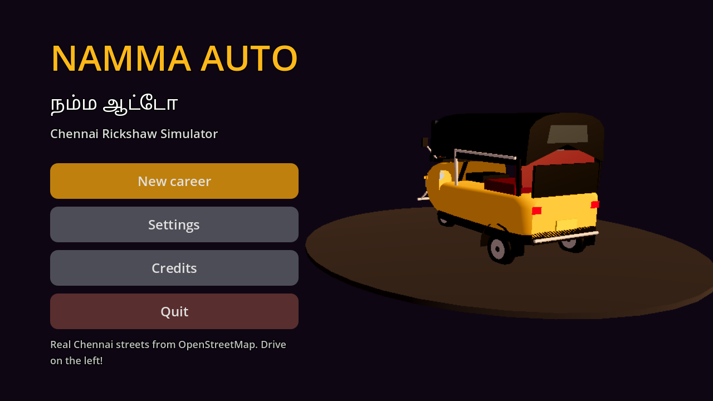 |  |  |

| Driving HUD | Chennai people on the kerbs |
|---|---|
| 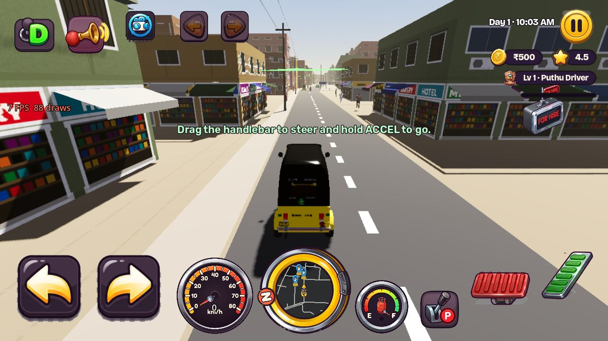 | 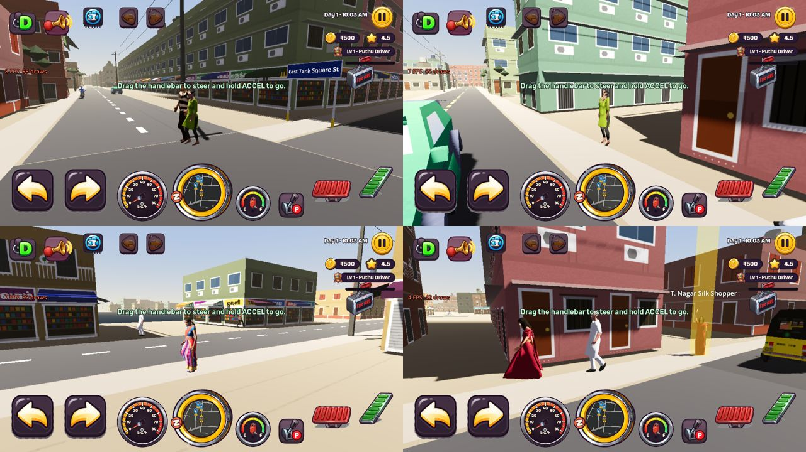 |

---

## 🚨 Launch command centre — 31 October to 14 November 2026

> **Priority override:** This section is the authoritative, current launch order. Older roadmap items further below are historical plans, **not** commitments for this two-week release. **Goal: a stable Android release candidate and Play testing/submission by 14 November**, not a guaranteed public production launch. No new missions, maps or vehicles until P0 issues are resolved.

**Current gate: NOT STORE READY.** User-supplied Android gameplay screenshots on 31 October confirmed a visible Mylapore workshop and usable repair/upgrades/paint menus, but also a nearly black tutorial overlay, a replacement-looking auto after blue paint, an apparently missing driver, floating vehicle/pedestrian visuals, and unclear "80 m" guidance text. Passing headless tests does not mean these visuals are accepted.

### Verified progress and current PRs

- [x] Existing playable driving, Chennai OSM/chunk map, Savari loop, fare settlement, route display, local saves, money/progression, tutorial framework and Android APK/AAB CI are implemented in code. **Real-device end-to-end release acceptance remains outstanding.**
- [x] PR #43 merged: map Drop Pin and dynamic reroute logic; original configured Chennai bounding box restored, but **baked world/road data boundary still needs verification**.
- [x] PR #44 merged: vehicle upgrade-speed configuration and physics baseline assertions; **real speed measurements remain outstanding**.
- [x] PR #45 merged: new Mylapore workshop GLB loaded at garage service point, initial shell collision geometry and regression tests. Mylapore workshop visually confirmed in user screenshots; garage entrance, surrounding empty space and collision placement not yet approved.
- [x] PR #46 merged: garage markers on mini-map, mini-map tap to full map, garage tap destination and Set Route integration. **Touch navigation on the user's installed APK needs explicit testing**.
- [ ] PR #47 **OPEN**, CI passed on its head at time of this audit: reduce tutorial spotlight opacity and prevent paint selection from switching the imported auto to different procedural geometry. **Do not mark resolved until merged and tested on Android.** Non-yellow paint remains visually unsupported on the imported textured body; color selection is saved but genuine model recoloring is not implemented.
- [ ] Traffic asset fix (this PR): the two-wheeler pack was one merged 16-bike showroom grid squeezed into each scooter box and scattered at 0.12 scale as parked props; it is now split into 4 real-size sport bikes (1 in 9 two-wheelers, the Activa-style scooter stays the default) and parked props are single real-size scooters/bikes. The Tripo police SUV was squashed 26 % flat into a saloon box with a near-black metallic texture; it is now baked at 4.5 m, uniformly fitted, flat white livery, 18.5k → 4.5k triangles. **Needs on-device look check; owner to confirm Tripo commercial-use rights.**
- [x] Existing garage tabs show repair price, engine/suspension/tyres, horn, paint and vehicle selection; screenshots confirm UI works. Improvements and comprehensive payment/save tests remain.

### Critical-first release backlog

| Order | Priority | Work and acceptance criterion | Status |
|---|---|---|---|
| 1 | **P0 BLOCKER** | Merge/test PR #47: first-ride tutorial cannot obscure the road/auto; blue paint must **never change chassis/wheels**. Retest all colors and reloading existing save. | [ ] CI green; manual acceptance pending |
| 2 | **P0 BLOCKER** | **Auto visual integrity:** implement material-separated or paint-mask recoloring of original `player_auto.glb`, never fallback to an unrelated body. Validate stock/blue/black side-by-side screenshots, correct wheels and roof. Disable misleading purchase options until visually supported. | [ ] |
| 3 | **P0 BLOCKER** | **Hero and ground contact:** confirm seated hero exists/loads during driving, hides appropriately on foot, and enters/exits without duplicate models. Fix auto wheel contact and pedestrian foot-to-pavement placement for slopes/LOD and verify from 3 camera angles. | [ ] |
| 4 | **P0 BLOCKER** | **First 10-minute player journey:** tutorial start/skip, kick-start, steering, braking, hail, pickup, fare, GPS, drop-off, cash, app relaunch, save/restore; no black screen, softlock, crash or broken touch target. | [ ] |
| 5 | **P0 BLOCKER** | **Garage/economy:** Mylapore bay entry without off-side prompt or invisible wall, upgrades apply to the actual auto, repaired condition remains persistent, insufficient money doesn't charge, painted model persists. | [ ] |
| 6 | **P0 BLOCKER** | **Release engineering:** green merged-main CI, signed release AAB with stable package/version and correct target API, install/upgrade test, audited permissions and asset licenses, store policy/privacy/data safety declarations. | [ ] |
| 7 | **P0 BLOCKER** | **Real Android QA:** full 20–30-minute run on at least a low/mid-range Android phone; benchmark FPS, draw calls, RAM, heat, crashes and map holes. Preserve 150-draw-call and 85 MB AAB budgets; no severe prolonged stalls. | [ ] |
| 8 | **P1 MUST IF TIME** | Garage G marker map navigation on device, valid arrival marker; fix tap/pan conflict. Label ambiguous "80 m" as next turn/pickup/garage distance depending on active guidance. | [ ] |
| 9 | **P1 MUST IF TIME** | Improve workshop orientation, visible parking-bay geometry, collision clearance, nearby empty spaces and garage menu preview; verify no roadside overlap. | [ ] |
| 10 | **P1 MUST IF TIME** | Fix major floating/overlapping traffic, NPC following deadlocks, map obstacles and unusable turn instructions encountered during the smoke test. | [ ] |
| 11 | **P2 DEFER** | Additional auto chassis, cinematic garage interior, extra workshop variants, story missions, expanded Chennai, extra landmarks (including previously removed Ripon/Central), deep customization, new gearbox/brake tiers, LiveOps. | [ ] Deferred until after first stable launch |

**Definition of launch blocker:** Any reproducible gameplay corruption, invisible/impossible navigation, unreadable tutorial, missing player model, bad vehicle identity, loss of currency/save, crash/ANR, Play policy/asset license problem or noninstallable AAB. No fake green checkmarks: each closure needs a build SHA, screenshot/video and reproduction/pass result.

### 14-day execution schedule (scope freeze)

| Dates (IST) | Delivery focus | Exit gate |
|---|---|---|
| **Oct 31 – Nov 2** | Merge PR #47 after device verification; lock auto mesh; resolve tutorial darkness and paint-model swap; investigate driver/ground contact; make screenshots baseline. | P0 regressions reproduced and assigned, no chassis swap |
| **Nov 3–5** | True recolor approach or hide broken color purchases; seated driver and ground contact fixes; camera/road/footpath acceptance; regression tests. | Player/auto look correct at all tested angles |
| **Nov 6–8** | Complete uninterrupted first ride, garage repairs/upgrades/save, route-to-garage flow; fix UI blockers and main-road collision issues. | One complete player loop on device with no blocking errors |
| **Nov 9–11** | Freeze new features; low-end Android 30-minute test, crash/performance correction, build size, signed release pipeline, policy/privacy/licensing and store assets. | Play-ready signed AAB + smoke-test evidence |
| **Nov 12–14** | Final integration and release candidate; Play internal/closed-test upload where eligible; submission or production-access application if account qualifies. | Tagged release candidate and documented Play Console state |

**Google Play reality:** New personal developer accounts created after 13 November 2023 generally need **at least 12 opted-in closed testers continuously for 14 days before applying for production access**. Google can also take additional time to review production access and app submissions. Therefore a **public Play Store release by 14 November cannot be guaranteed** if the required testing has not already started or production access is not yet approved. Source: [Google Play testing requirements](https://support.google.com/googleplay/android-developer/answer/14151465); [Google Play review timing](https://support.google.com/googleplay/android-developer/answer/9859654). Start Play Console setup/testing track work **now**, in parallel with fixes; do not defer it to the final day.

### Owner tasks — start immediately

- [ ] Confirm Play Console access, account type and whether production access is already granted; if closed testing is required, enroll at least 12 engaged testers **as soon as a compliant test build is available**.
- [ ] Download latest merged-main debug APK and attach screenshot/video after PR #47 lands: first tutorial, stock auto side/rear, painted auto side/rear, seated driver, pedestrians on sidewalk, garage entrance and map guidance.
- [ ] Provide a 20–30 minute device run (model, Android version, FPS, heat/crash notes), plus whether another 3–4 GB RAM test phone is available.
- [ ] Prepare Play listing, screenshots, icon, privacy-policy URL, declarations and signing credentials **privately in GitHub secrets**, never in PR text/chat. Verify the model/texture redistribution rights for every imported asset.

### Release cut line

**Ship only**: one trustworthy player auto with authentic silhouette and consistent paint behavior, one usable physical garage, passenger-earning loop, GPS/garage wayfinding, stable save/upgrade purchases, tutorial, device-performance acceptance and store compliance. **Do not block shipping on** additional autos, new stories, weather realism beyond stability, garage cinematic scenes or extra city extensions.

---

## 📌 At a glance

| | |
|---|---|
| **Genre** | Open-city driving + economy sim (hybrid-casual / mid-core) |
| **Platform** | **Android only** (Google Play), arm64-v8a + armeabi-v7a |
| **Engine** | Godot 4.4.1 (pinned in CI), Mobile renderer + GLES3 fallback, Jolt Physics 3D |
| **Language** | Fully statically typed GDScript 2.0 (untyped declarations are errors) |
| **Target device** | Helio G85 / Snapdragon 680, 3–4 GB RAM, 60 FPS |
| **Budgets** | ≤ 150 draw calls · ≤ 18 pooled AI vehicles · < 85 MB `.aab` |
| **Map** | Real size (1 : 1), 7.0 × 5.9 km; latest density rebuild reports **28,355 total buildings (16,871 OSM + 11,484 infill)** |
| **Languages** | English and தமிழ் (UI), Tanglish rider dialogue |
| **Monetization** | Hybrid: rewarded + capped interstitial ads (placeholder provider today), Play Billing IAP later |
| **Version** | `0.5.0-mvp` development build · 11 headless suites; latest merged-main CI must be checked before release |
| **Status** | **Pre-release, NOT store-ready.** Core game implemented; world visuals, manual Android QA, missions, platform integrations and release compliance remain open |

### Design pillars
1. **Madras Soul** – real Chennai streets, Tamil/English boards, TN buses and lorries, sarees and veshtis on the kerbs, Tanglish riders.
2. **Immediate freedom** – the whole city, Free Roam and Savari are open at install. Levels only unlock cosmetics and the EV.
3. **Meter vs. Bargain** – 5-second fare haggling, LPG/EV management, auto condition, Auto Stand respect.
4. **AI-agent modularity** – `SignalBus` decoupling, tunables in `.tres` resources, generated data, headless CLI tests.

---

## 🎮 What's in the game today

**Driving**
- 3-wheel raycast delta-trike (1 steerable front wheel, 2 rear drive wheels) with anti-roll, two-wheel "Gethu" tilt, torque curve and aero drag (0–35 km/h in 2.8 s, 58 km/h top).
- Real reverse gear (D/R), indicators with lamps and relay tick that self-cancel after the turn, brake/reverse lamps, handbrake, three horn tiers that decide which traffic gives way.
- Chase, cockpit (stabilised "neck") and top-down cameras; drag to orbit the chase camera freely; physics interpolation for smooth motion.
- Monsoon flood spots stall the engine; kick-start back to life in a steady rhythm (mashing floods it).
- Collisions: sliding chamfered hull, crunch/scrape sounds, sparks, dust, camera jolt, haptics; crashes wear the auto's condition.
- Comfort pack: auto-recover when flipped, "Reset auto" when stuck, compact guidance distance in the top HUD, gentle steering curve, speed-based FOV.

**Chennai**
- Real roads from OpenStreetMap through A/B Street's osm2streets (lanes, sidewalks, junctions, markings; left-hand driving), streamed in 250 m chunks on worker threads.
- OSM building footprints plus procedural infill (28,355 total in the latest density build) with a Chennai facade atlas (grilled windows, sunshades, balconies, AC units, Tamil/English shop boards, temple stripes), parapets, stair head-rooms with black Sintex tanks, awnings; lit windows at night.
- EB poles with sagging wires, neem trees and palms, Greater Chennai Corporation street-name boards with real OSM names (Tamil + English), name boards on real named buildings.
- Landmarks: procedural Marina lighthouse and gopuram, TWAD water towers, canal-side settlements, NAMMA GAS stations; traffic police at big junctions.
- Temple tanks and lakes use faceted low-poly water with solid concrete edge barriers; auto stands have parked autos, cars and two-wheelers.
- Day/night on the shift clock (noon glare → golden Marina evening → night) and the Northeast Monsoon (rain, windscreen drops + working wiper, wet roads, 5 real flood-prone spots).
- Mixed traffic (scooters with riders, cars, share autos, TNSTC/SETC buses, lorries, service vehicles) whose density follows the TomTom 2025 Chennai hourly profile; 14 animated pedestrians that walk the kerbs and jump out of the way.

**Savari (the money loop)**
- Riders wave you down at 3 auto stands and on kerbs; 5 archetypes (IT commuter, T. Nagar silk shopper, Marina tourist, monsoon rider, college student).
- 5-second haggle card: Correct Meter / Meter Mela / Fixed price, judged against the Chennai meter (₹35 + ₹18/km), your star rating, greed streak and demand.
- Sat-nav ribbon in your lane with flowing chevrons, turn-by-turn banner with real street names, heading-up mini-map, full-screen OSM map (pan, pinch, POIs).
- Mini-map service pins identify LPG bunks, EV kiosks and garages; fuel stations show parked vehicles and pump islands.
- Tea-cup comfort meter, Gap-la Gethu near-miss bonus, ride timer, fare breakdown with tips, Respect XP and rolling star rating.

**Career and progression**
- Wallet, LPG (₹62/L at 4 bunks) or EV charge (₹12/kWh at 3 kiosks), condition and repair, ₹150 tow when you run dry.
- Garage service points at Mylapore, Marina and T. Nagar (physical workshop GLB currently at Mylapore): repair, engine/suspension/tyre upgrades, horns, paints (Alangaram), 3 autos (Singara Classic, Madras King Deluxe ₹1,000, Namma Green EV ₹3,000).
- Shift clock 6 AM → 10 PM in 18 real minutes, end-of-day summary, 3 shift goals per day.
- Driver Level 1–20 with stand titles (Puthu Driver → Madras Legend), ₹50 × level bonuses, cosmetic unlocks.
- Rewards engine: idempotent ledger, daily caps, 7-day login calendar, 11 achievements (Play Games ids ready), rewarded 2× fare / half tank / free tow.
- **First-ride tutorial** with Murugan Anna of the Mylapore stand: kick-start → pull out → stop line → indicate → honk → pick up → haggle → GPS → drop off (+₹100) → free roam. Skip, replay and resume per step.

**Shell**
- Live splash → main menu (Continue / New career / Settings / Credits / Daily reward / Achievements) → threaded loading screen with tips.
- Settings: controls (steer buttons / handlebar drag / tilt), graphics Low/Medium/High (auto-picked from RAM), English / தமிழ், volumes, brake-to-reverse, replay tutorial.
- Encrypted, device-bound save with checksum; autosave after rides, purchases, every 60 s and on app pause. Android back button pauses/resumes.
- Ad policy service with a mock on-screen placeholder: no ads in the first minutes, never while driving or during the tutorial, capped and spaced interstitials, opt-in rewarded ads.

### Controls
| Action | Touch | Keyboard (editor testing) |
|---|---|---|
| Accelerate / Brake | right pedals | W/↑ · S/↓ |
| Gear D ↔ R (stop first) | D/R button | R |
| Indicators left / right | arrow buttons at the top | Q · E |
| Steer | steer buttons bottom-left (or handlebar drag / tilt in Settings) | A/← · D/→ |
| Handbrake | P lever | Space |
| Horn ("Pom-Pom") | horn button | H |
| Kick-start (shown only when the engine is off or flooded) | KICK | K |
| Camera (Chase → Cockpit → Top-down) | camera button | C |
| Wiper (shown in rain) | WIPER | V |
| Full map | tap the mini-map | M |

With **Brake to reverse** on (default), holding BRAKE at a stop engages R; then BRAKE drives backwards and ACCEL stops you and returns to D.

---

## 🏗️ Architecture

Every system is a node in one game scene that talks to the others **only through the `SignalBus` autoload** (no cross-scene `get_node` paths). `GameState` is the single source of truth for the profile and the save. Touch, keyboard and tests all press the same InputMap actions, so the headless test bots drive the real game.

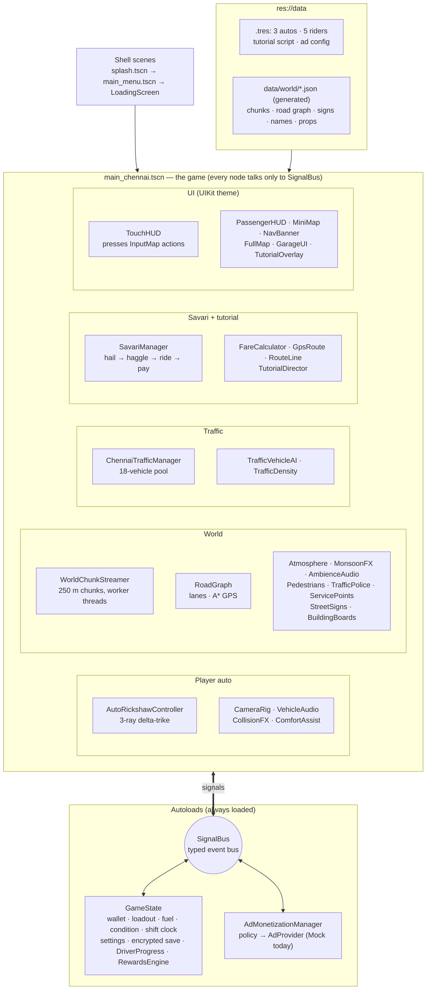

**Scene flow:** `splash.tscn` (engine boot splash, then a live progress bar) → `main_menu.tscn` → `LoadingScreen` (threaded load, survives the scene change) → `main_chennai.tscn`. `main_phase1_greybox.tscn` is the physics test strip (speed breaker at 180 m, flood puddle at 320 m).

**Key rules** (full list in [`AGENTS.md`](AGENTS.md)): communicate through `SignalBus`; type everything; tunables live in `.tres`; never fake 4-wheel physics; never `instantiate()`/`queue_free()` while driving (traffic, riders and people are pooled); ≤ 150 draw calls (one mesh per chunk for roads, one for buildings + dressing); `data/world` is generated, never hand-edited.

### Build pipelines

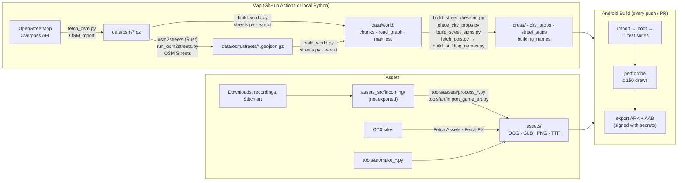

---

## 🧱 Tech stack

| Layer | Choice |
|---|---|
| Engine / physics | Godot 4.4.1 + Jolt; custom 3-point raycast delta-trike (based on `DAShoe1/Godot-Easy-Vehicle-Physics`) |
| Roads & lanes | [`a-b-street/osm2streets`](https://github.com/a-b-street/osm2streets) (Apache-2.0), built in CI; lane counts and widths drive the AI traffic |
| Map pipeline | OpenStreetMap (Overpass) → osm2streets + `tools/osm/build_world.py` → pre-triangulated JSON chunks (250 m, 3×3 streaming), 1 : 1 scale |
| UI | Code-built screens on one cached `UIKit` theme ("Namma Auto Arcade" design from Google Stitch), painted atlases |
| Ads | `AdMonetizationManager` policy + `AdProvider` interface; `MockAdProvider` today, `AdMobProvider` bridge for Poing Studios `godot-admob` ready to switch on |
| IAP (planned) | Google Play Billing (`godot-google-play-billing`), UPI via Play checkout |
| Save / social | Encrypted local save; Play Games Services v2 (achievement ids reserved) later |
| Assets | CC0 / CC BY / Pixabay only: Kenney, Quaternius, Sketchfab CC BY authors, Freesound, BigSoundBank, Pixabay, Google Fonts — see [`assets/README.md`](assets/README.md) |
| Agent tooling | `satelliteoflove/godot-mcp`, `Coding-Solo/godot-mcp` (optional live playtests) |

---

## 📂 Repository layout

```text
.
├── AGENTS.md                 # Agent constitution: rules, lessons, verification loop — read before every task
├── project.godot             # Config, InputMap, autoloads, Jolt (20 km world boundary), 60 Hz physics
├── export_presets.cfg        # Android: APK + Gradle App Bundle (arm64 + armv7); data/world/* in include_filter
├── .github/workflows/        # android-build (tests → perf → APK/AAB), osm-import, osm-streets, osm-pois,
│                             #   fetch-assets, fetch-fx
├── autoloads/                # SignalBus, GameState, AdMonetizationManager
├── data/
│   ├── vehicles/             # VehicleStats.gd + 3 autos (.tres)
│   ├── passengers/           # PassengerArchetype.gd + 5 riders (.tres)
│   ├── tutorial/             # TutorialStep/TutorialScript + first_ride.tres
│   ├── monetization/         # AdConfig.gd + ad_config.tres (every ad-frequency number)
│   ├── osm/                  # raw Overpass extract + osm2streets output (input only, not exported)
│   └── world/                # GENERATED map: manifest, road_graph, areas, chunks/, dress/, signs, names, props
├── scenes/                   # splash, main_menu, main_chennai (game), main_phase1_greybox, vehicles/, traffic/, ui/
├── scripts/
│   ├── vehicle/              # AutoRickshawController, CameraRig, VehicleAudio, CollisionFX, ComfortAssist,
│   │                         #   AutoRickshawModel, WheelModel, MeshKit
│   ├── world/                # WorldChunkStreamer, RoadGraph, Atmosphere, MonsoonFX, WaterlogZone, ServicePoints,
│   │                         #   AmbienceAudio, PedestrianManager, PersonMesh, WaveModifier, TrafficPolice,
│   │                         #   StreetSigns, BuildingBoards, LandmarkKit, ViewCheck, GreyboxDressing
│   ├── traffic/              # ChennaiTrafficManager, TrafficVehicleAI, TrafficDensity, TrafficModelFit
│   ├── passengers/           # SavariManager, FareCalculator, GpsRoute, RouteLine
│   ├── progression/          # DriverProgress (levels, shift goals), RewardsEngine (ledger, daily, achievements)
│   ├── tutorial/             # TutorialDirector
│   ├── monetization/         # AdProvider, MockAdProvider, AdMobProvider
│   └── ui/                   # UIKit, MainMenu, SplashScreen, LoadingScreen, ChennaiBackdrop, TouchHUD,
│                             #   PassengerHUD, MiniMap, FullMap, NavBanner, GarageUI, TutorialOverlay, UISfx, DebugOverlay
├── shaders/                  # building_facade (atlas + night glow), rain_overlay (rain, drops, wiper)
├── translations/ui.csv       # English / Tamil UI strings (tr keys)
├── assets/                   # ALL game art and sound — catalog + how to add/replace: assets/README.md
├── assets_src/incoming/      # raw downloads waiting to be processed (not exported, mostly git-ignored)
├── tools/
│   ├── osm/                  # map pipeline (fetch, osm2streets, build_world, dressing, signs, names, heights, preview)
│   ├── assets/               # audio/model/people/city processors, CC0 fetchers (Python + gltf-transform)
│   └── art/                  # facade atlas, UI icons, Stitch art importer, station branding
├── tests/                    # run_phase1…11_tests, run_perf_probe, probes and screenshot helpers (shot_*.tscn)
└── docs/                     # ASSETS.md (download list), MISSIONS_PLAN.md, PLAYTEST_OCT26.md, images/
```

---

## 🎨 Assets

All shipped art and sound is in [`assets/`](assets/), one folder per kind. The full catalog (every file, what uses it, source, licence, and the tool that rebuilds it) and the **step-by-step guide to add or improve an asset** are in **[`assets/README.md`](assets/README.md)**. Where to download more: [`docs/ASSETS.md`](docs/ASSETS.md).

| Folder | What | Main sources | Licences |
|---|---|---|---|
| `assets/audio/` (1.9 MB) | Engine (LPG, diesel), kick-start, horns, indicator, crashes, city/sea/market/rain ambience, UI sounds | kalhan (Freesound), Pixabay, BigSoundBank, Kenney | CC BY 4.0, Pixabay, CC0 |
| `assets/models/vehicles/` | Player auto (stock yellow) | rSquare (Sketchfab) | CC BY 4.0 |
| `assets/models/traffic/` | Scooter, hatchback, share auto, TNSTC/SETC buses, lorry, cows, 6 service vehicles | Shiveloper, Kenney, rSquare, Nobel Tech, Oren garage, Quaternius, Fadly.W, Comrade1280 | CC BY 4.0, CC0 |
| `assets/models/people/` | 9 walking Chennai characters (veshti, sarees, churidar, pavadai…), 2 police | Sketchfab CC BY authors | CC BY 4.0 |
| `assets/models/city/` | Mylapore garage workshop, water tower, canal settlement, gas station | Sketchfab CC BY authors | CC BY 4.0 |
| `assets/fx/` | Sparks, smoke, dust, puffs | Kenney particle packs | CC0 |
| `assets/textures/` | Chennai facade atlas + night glow | generated (`tools/art`) | ours |
| `assets/ui/`, `assets/icon/` | Controls, HUD dials, rewards, portraits, logo, loading art, app icon, splash | Google Stitch art for this project | ours |
| `assets/fonts/` | Bricolage Grotesque, Rubik, Noto Sans Tamil, Baloo Thambi 2 | Google Fonts | SIL OFL 1.1 |

Also procedural (no files): the legacy alternate auto body (not suitable as a paint replacement), roads and buildings from OSM, lighthouse and gopuram, scooter riders, menu skyline, rain shader, synth fallback sounds.

---

## 🚀 Getting started

```bash
git clone https://github.com/DavidRajPaul/Auto-Simulator-Game-GoDot.git
cd Auto-Simulator-Game-GoDot

godot --headless --path . --import                                            # import assets
godot --headless --path . --fixed-fps 60 res://tests/run_phase1_tests.tscn    # one suite (exit 0 = pass)
xvfb-run -a godot --path . --rendering-method gl_compatibility --fixed-fps 60 res://tests/run_perf_probe.tscn
```

Open the folder in **Godot 4.4.1** and press Play (keyboard controls above). The game starts on the splash, then the menu.

### Test suites

Suite numbers follow the order they were written, not the roadmap phases.

| Suite | Covers | Checks |
|---|---|---|
| `run_phase1_tests` | Vehicle physics, traffic pool, horn, HUD, flood + kick-start | 50 |
| `run_phase2_tests` | World data, chunk streaming, traffic on real roads | 32 |
| `run_phase3_tests` | Fares, haggling odds, GPS routing, full rides | 45 |
| `run_phase4_tests` | Garage economy, fuel, condition, save/load, shift, settings, "2nd auto in ~30 min" | 51 |
| `run_phase5_tests` | 1 : 1 world, comfort pack, day/night, monsoon, menu, back button | 34 |
| `run_phase6_tests` | Gears, indicators, give-way, driver levels, goals, facades, sounds | 66 |
| `run_phase7_tests` | UI kit and screens: home, haggle, ride complete, level-up, menus hide HUD | 22 |
| `run_phase8_tests` | Play-test pass: camera, shadows, splash, riders, bargaining, time-of-day traffic, rewards, ads | 55 |
| `run_phase9_tests` | Chennai people, building detail, street dressing, buses, lorry, landmarks | 35 |
| `run_phase10_tests` | Play-test round 2: street boards on the footpath, GCC look, tree mix, impact FX, icons | 28 |
| `run_phase11_tests` | First-ride tutorial: bot plays all 10 steps, skip, replay, resume, scripted world | 47 |
| `run_perf_probe` | Draw calls and traffic pool while driving the city and the greybox (needs a display) | 98 / 150 max (Oct 27) |

## 📦 Android builds (GitHub Actions)

Every push and PR to `main` runs **[Android Build](.github/workflows/android-build.yml)**:

1. **Tests + perf budget:** import, boot the main scene, run all 11 suites, then drive the city and the greybox under a virtual display and fail above 150 draw calls. Results go in the run summary.
2. **Export:** Godot 4.4.1 + export templates (cached) + JDK 17 → `NammaAuto-debug.apk` (arm64-v8a + armeabi-v7a) and a Gradle-built `NammaAuto-debug.aab`. The CI checks the APK contains the map data and reports the size against the 85 MB budget. Version code = run number.
3. **Download:** Actions → latest run → *Artifacts* → `NammaAuto-android-<run>`; `adb install -r NammaAuto-debug.apk`.
4. **Release builds:** with repo secrets `ANDROID_KEYSTORE_BASE64`, `ANDROID_KEY_ALIAS`, `ANDROID_KEYSTORE_PASSWORD`, CI also signs `NammaAuto-release.apk` / `.aab` (the one for Play).
5. **Tags:** pushing `v*` attaches the APK and AAB to a GitHub Release.

Other workflows (manual): **OSM Import** (re-fetch OSM, rebuild `data/world`), **OSM Streets** (build osm2streets, new lane geometry), **OSM Named Places** (building names), **Fetch Assets** (CC0 sounds), **Fetch FX Textures** (Kenney particles).

---

## 🚦 Historical implementation ledger — 29 October 2026 (superseded by launch command centre)

**Historical snapshot only — see the launch command centre above for current priorities.** **Legend:** [x] merged into `main` / implemented in code; [ ] still requires work or acceptance. A checked box **does not** mean a successful manual Android playtest. **All PRs #13–#30 are merged** as of this audit; the latest merged-`main` Android workflow was still running when this README was updated. [Android CI](https://github.com/DavidRajPaul/Auto-Simulator-Game-GoDot/actions/workflows/android-build.yml).

### Implemented in the repository

- [x] Core three-wheel physics, driving controls, camera, HUD, collisions, reverse, indicators, horn, vehicle audio, garage, LPG/EV, save/load.
- [x] Real-size OSM roads, lane geometry, chunk streaming, buildings, facade details, pedestrians, city traffic, Chennai landmarks and auto stands.
- [x] Savari passenger loop, fares and haggling, GPS, navigation, driver progression, rewards and first-ride tutorial.
- [x] Procedural clouds (PR #17), organic Chennai trees and palms (PRs #18, #23), monsoon puddles, drag, flood stalls, overlapping flood depth and rescue (PRs #19–#22), three-wheel splash FX (PR #24).
- [x] Lead-vehicle speed-aware following and braking (PR #25), intersection yielding (PR #26), flood-aware NPC slowdown (PR #27).
- [x] Denser frontage and second-row infill plus separate vertex-coloured roadside-tree rendering (PR #28). **Generated data and CI passed on the PR; visual realism on Android remains unaccepted.**
- [x] Marina animated ocean surface and return-to-land guard (PR #29). **Shoreline-breaking waves and natural physical water interaction are not implemented.**
- [x] GCC street-sign glyph fitting, post/plate collision, first-hit bending, second-hit fall and 35-second reappearance (PR #30). **Animation, text containment and collision still require Android verification.**
- [x] CI test suites and Android APK/AAB pipeline, including PR-specific successful checks for #28–#30.

### Required acceptance / bug-fix backlog — prioritize before new missions

- [ ] **P0** Download a fresh APK from the **merged `main` SHA**, run the [full manual regression checklist](docs/MANUAL_ANDROID_REGRESSION.md) and record build SHA, device and video evidence. PR-specific green checks do not replace a merged-main device test.
- [ ] **P0** Verify denser Chennai streets from the auto camera in Mylapore, T. Nagar, Anna Salai and Triplicane; fix remaining empty lots, road/building overlaps and unnatural repeating facades.
- [ ] **P0** Verify roadside trees actually render in the APK. Replace/improve placeholder procedural foliage with licensed, Chennai-appropriate low-poly realistic coconut, neem, rain-tree, Ashoka and copper-pod models; add near/far LODs and batching.
- [ ] **P0** Verify Marina animated water, beach access and ocean safety from multiple directions; eliminate unintended teleporting, shoreline gaps and ability to drive over sea. Improve coastal breaking-wave/foam visuals.
- [ ] **P0** Verify GCC sign text stays within blue plates in English and Tamil, collision blocks the auto, first impact bends, second impact breaks/falls, and repair restores the correct sign. Fix any jitter or invisible collision.
- [ ] **P0** Verify NPC following, junction yielding and flood speed behavior under dense traffic; fix deadlocks, overlapping vehicles and collisions with the player.
- [ ] **P0** Verify flood stalls, wheel splashes, kick-start restrictions, towing, fuel, saves, tutorial and passenger payout on Android.
- [ ] **P0** Profile 20–30 min on 3–4 GB Android phones (traffic + monsoon + dense city); achieve target FPS without severe thermal throttling, excessive draw calls or memory crashes.
- [ ] **P1** Create recognizable, optimized models of Chennai Central, Ripon Building, LIC Building, Valluvar Kottam, Kapaleeshwarar Temple, Marina Lighthouse and Napier Bridge, using licensed references and real scale. Some landmarks are already represented procedurally or as imported models; **visual authenticity is not accepted yet**.
- [ ] **P1** Complete visible auto damage and repair visuals (Phase 6), mission engine (Phase 7), eight story missions (Phase 8), localized content and voice polish (Phase 9).
- [ ] **P0 launch** Replace mock ads with production SDK/consent or deliberately remove ads; implement and test Play Billing if paid products ship. Configure Play Games/cloud save only if retained in launch scope.
- [ ] **P0 launch** Finalize keystore, Play App Signing, current target API and AAB, privacy policy, Data Safety, content rating, attribution/licence audit, store listing, screenshots and trailer.
- [ ] **P0 launch** Complete Play internal/closed testing and meet **the actual Play Console requirements for this account** (do not assume the 12-testers/14-days rule applies to every account).
- [ ] **P0 launch** Triage crashes/ANRs, conduct final regression and staged production rollout. No launch date is committed.

### Free AI 3D asset generation — shortlist (not yet imported)

| Tool | Free access / important limits | Best use |
|---|---|---|
| [Tripo Studio](https://www.tripo3d.ai/) | Free 200 credits/month; free 3D export limited to H2.5; free output requires attribution and platform retains IP under current plan terms. [Official pricing](https://www.tripo3d.ai/product-doc/getting-started/pricing-credits) | Browser-based image-to-3D tree/landmark trials |
| [Meshy](https://www.meshy.ai/) | Free 100 credits/month, **10 monthly downloads of untextured Meshy 6 Lite only**; newer/textured model exports are paid. Free output CC BY 4.0 with attribution. [Official limits](https://help.meshy.ai/en/articles/10421033-why-can-t-i-download-my-model) | Fast browser previews and geometry prototypes |
| [AssetFurnace](https://github.com/Bingeljell/image-to-3dlab) | Free self-hosted/open-source UI, **requires a capable local GPU/Mac**, and model weights have their own licences. | Zero-credit repeatable image-to-GLB pipeline when hardware is available |

**Recommended workflow:** take a properly licensed, isolated reference photo or original concept image → image-to-3D → Blender decimation/manual cleanup → low-poly GLB → Godot import → LOD, collision and batching → Android FPS test. Do **not** commit AI output before verifying licence, likeness, scale, texture resolution and triangle count. For trees, start with coconut palms, rain trees and neem; for iconic buildings, start with Ripon Building and Chennai Central, then the temple and lighthouse. AI models are **not automatically game-ready**.

# 🗺️ Roadmap

Legend: ✅ done · 🟡 partly done · ⬜ not started · **(you)** needs the owner or a real phone. **Android only.**

| Part | Phase | Status |
|---|---|---|
| A · MVP | 1 Core physics · 2 Chennai world · 3 Savari loop · 4 Economy & garage · 5 Polish → MVP | [x] code; [ ] Android device acceptance |
| A+ · Post-MVP | Controls & levels · UI art · city & people · rewards & ad placeholders · first-ride tutorial | [x] code; [ ] visual QA |
| B · Story content | **6 Visible damage** · 7 Mission engine · 8 Eight Chennai missions · 9 Content polish & voice | [ ] pending |
| C · Launch | 10 Monetization & platform · 11 Compliance & store · 12 Closed testing · 13 Soft launch · 14 LiveOps | [x] ad policy/mock; [ ] production integrations and release |

The detailed plan for Part B (with build tasks, tests and risks) is in **[docs/MISSIONS_PLAN.md](docs/MISSIONS_PLAN.md)**.

## Part A — MVP ✅ code complete

### Phase 1 · Core greybox & 3-wheel physics ✅ code · device gate **(you)**
- `AGENTS.md`, `project.godot` (InputMap, autoloads, Jolt, 60 Hz, strict typing), `SignalBus`, `GameState`.
- `AutoRickshawController`: 3-ray suspension, anti-roll, two-wheel Gethu, water stall + kick-start, passenger mass/CoM, fuel burn, odometer; feel-tuned (0–35 km/h 2.8 s, 58 km/h top, 2.1 m U-turn radius).
- `CameraRig` (chase / cockpit / top-down), `ChennaiTrafficManager` + `TrafficVehicleAI` (18-vehicle pool, sub-lanes, gap seeking, horn tiers), `TouchHUD`, `DebugOverlay`, greybox test strip.
- CI: tests → perf probe → APK.
- **Exit gate:** throttle 4 s → ≥ 35 km/h; full steer at 30 km/h keeps roll < 22°; horn shifts AI within 18 m ✅ (tests); steady 60 FPS on the budget phone ⬜ **(you)**.

### Phase 2 · Chennai world ✅ code · device gate **(you)**

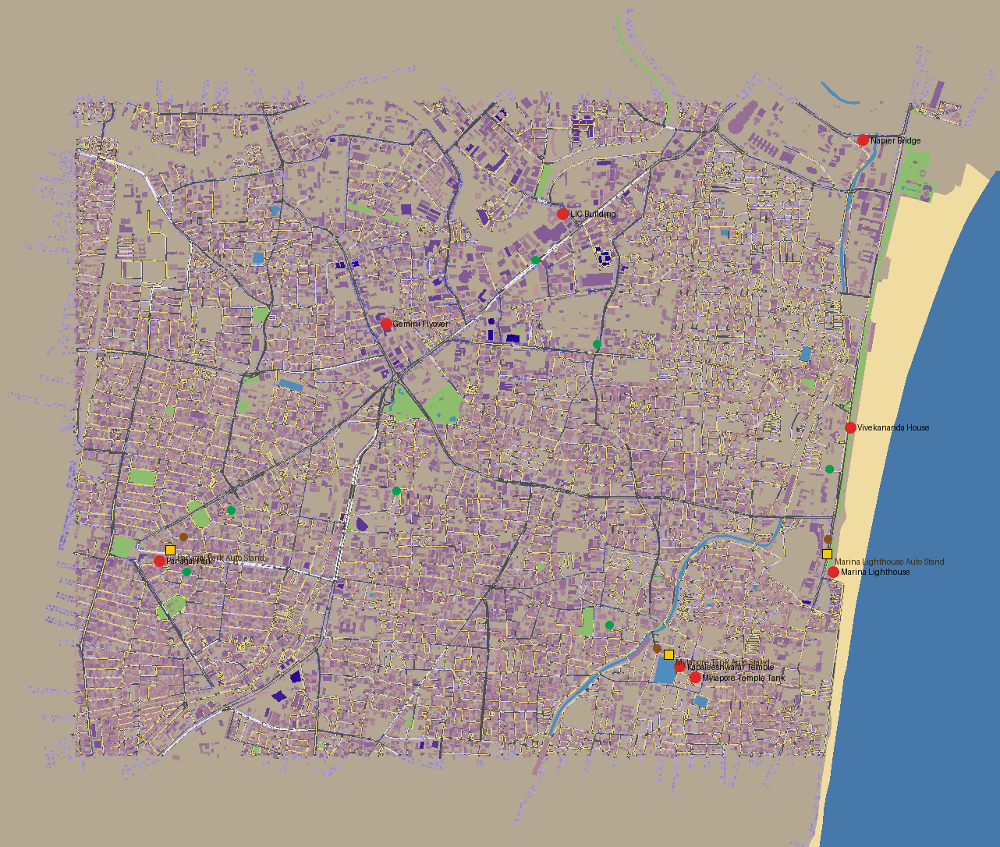

- OSM pipeline (`tools/osm`, OSM Import workflow) → `data/world/`; `WorldChunkStreamer` (250 m chunks on worker threads, ~2 draw calls per chunk); `RoadGraph` (left-hand sub-lanes, junction turns, strongly connected for GPS).
- Sea, beach, temple tank, Buckingham Canal / Adyar, parks; landmarks at real positions; 3 auto stands (Mylapore Tank, Marina Lighthouse, Panagal Park).
- Stray cattle (built, switched off after play-test feedback: `stray_cattle_enabled = false`).
- Superseded in Phase 5: the map went from 1 : 2.5 to **real size** with osm2streets lanes and real footprints.
- Open: jaywalkers in market zones ⬜; Gemini Flyover / Napier Bridge as real elevated ramps ⬜; drive all zones at 60 FPS, RAM < 400 MB on device ⬜ **(you)**.

### Phase 3 · Savari & "Meter vs. Bargain" ✅ code

| Haggle card | Ride with GPS |
|---|---|
|  | 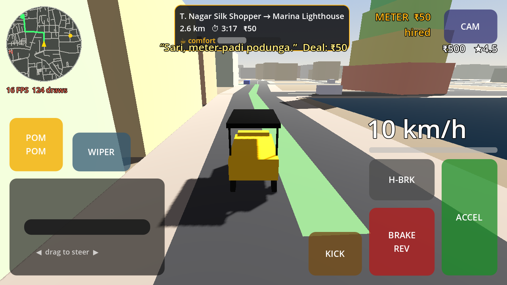 |

- 5 archetypes as `.tres` with Tanglish lines; hails at stands and kerbs weighted by zone; 5-second haggle card; `FareCalculator` (Chennai meter, odds, rain and Alangaram modifiers, tips, stars).
- GPS (A* on the road graph, one-ways, auto re-route), mini-map, tea-cup comfort, Gap-la Gethu near misses, ride timer, fare breakdown, Respect XP, star rating, wallet, meter flag.
- **Exit gate:** 30-minute session of continuous rides with no crash ⬜ **(you)**; fare maths covered by tests ✅.

### Phase 4 · Economy, garage & vehicles ✅ code

| Singara Classic | Madras King Deluxe (Black-Gold) | Namma Green EV |
|---|---|---|
|  | 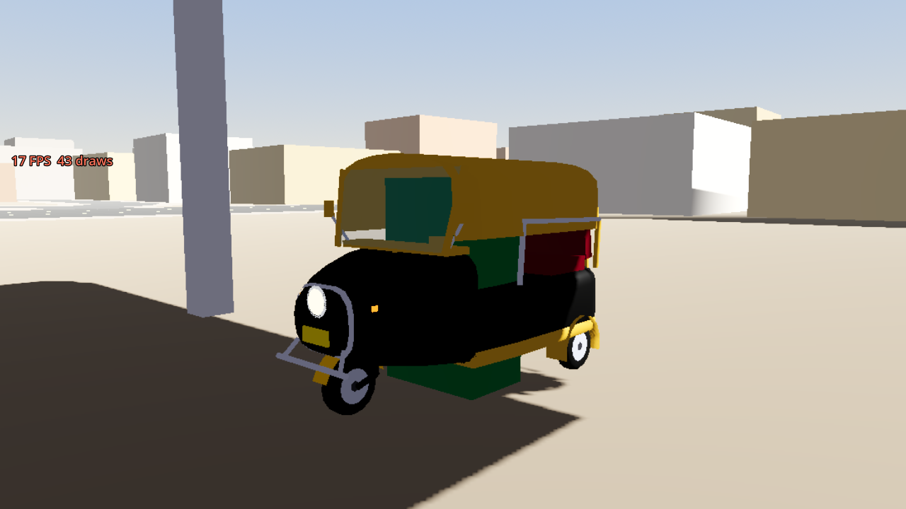 | 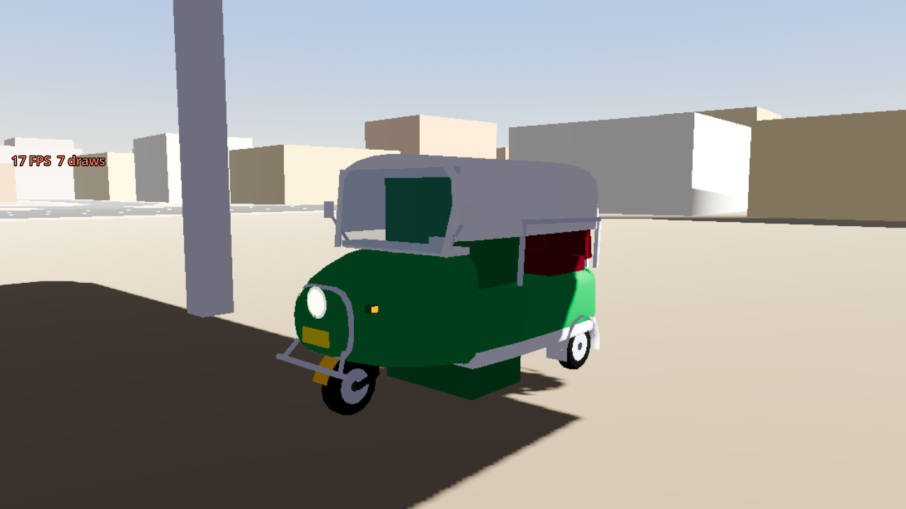 |

| Garage | Settings in Tamil |
|---|---|
| 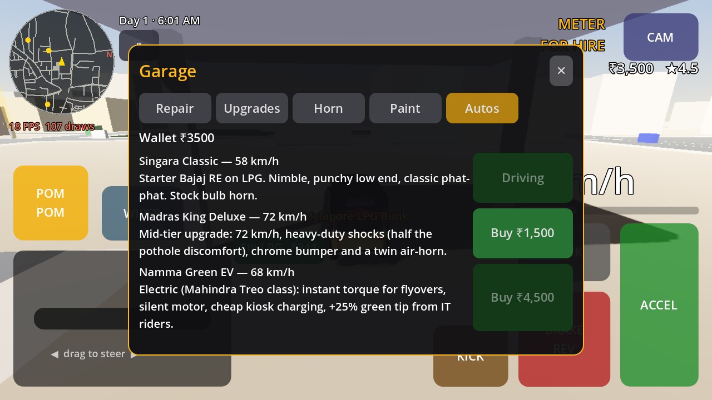 | 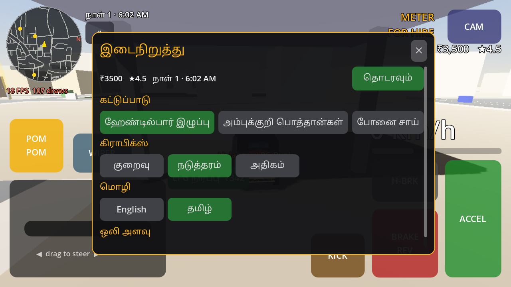 |

- Procedural Bajaj RE body (repaints in the garage), 3 autos, garage (repair, upgrades × 3 levels, horns, paint, buy/switch), LPG bunks / EV kiosks / tow, condition, shift clock + summary, encrypted save, settings incl. tilt and Tamil.
- **Economy note:** the GDD prices the King Deluxe at ₹15,000 but also wants it in ~30 minutes; on the real map rides earn ~₹50–110, so it costs ₹1,000 (EV ₹3,000). The test simulates ~8 rides to afford it.
- **Exit gate:** unlock the 2nd auto in ~30 min ✅ (simulated); save survives app kill ✅ (autosave on pause) — confirm on device **(you)**; tilt axis on a real phone ⬜ **(you)**.

### Phase 5 · Polish → MVP ✅ code · device gate **(you)**

| Mylapore at 1 : 1 (osm2streets lanes, real footprints) | Facades and controls |
|---|---|
| 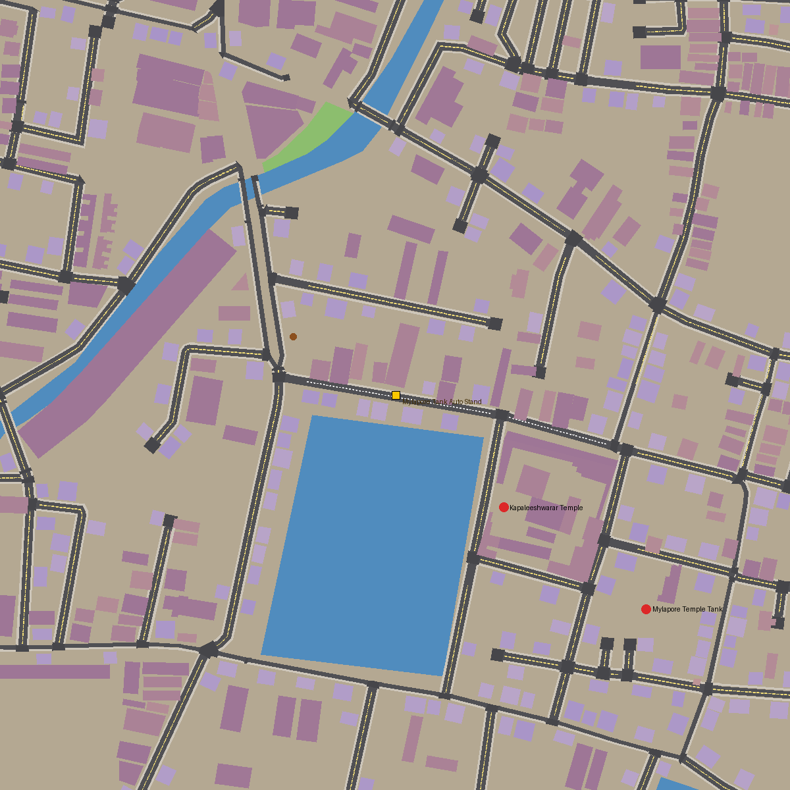 | 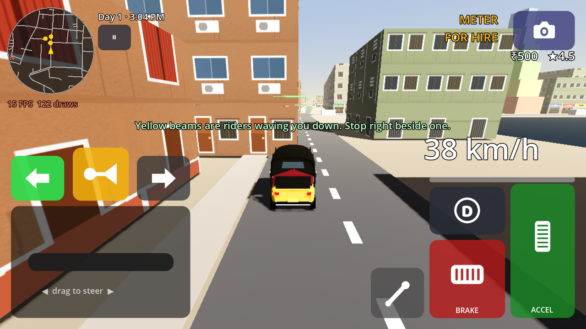 |

- Real-size map (7.0 × 5.9 km) from osm2streets (13k lanes, 5.5k junctions); denser generated infill added in PR #28; one wall collider per chunk; Jolt world boundary raised to 20 km.
- Comfort pack, day/night, Northeast Monsoon with flood spots, kick-start rhythm, main menu, Android back button, AAB in CI.
- **MVP exit gate:** feature-complete loop ✅; `.aab` < 85 MB (CI reports it); 60 FPS for 20 minutes without dropping below 45 FPS ⬜ **(you)**; zero known crashers.

## Part A+ — Post-MVP updates ✅

| Update | What landed | Suite |
|---|---|---|
| Controls & progression | Reverse gear, indicators with give-way, brake/reverse lamps, facade atlas building skins, Driver Level 1–20 + 3 shift goals, UI/ambience audio | 6 |
| Game UI (Stitch art) | `UIKit` theme, painted controls/HUD/rewards atlases, home, haggle, ride-complete and level-up screens, menus hide the HUD | 7 |
| Play-test pass (26 Oct) | Smooth camera, stepped sun shadows, live splash, scooter riders, people at pickups, stricter bargaining, TomTom traffic, sat-nav ribbon + turn banner, full map, street boards, collision overhaul, `RewardsEngine`, ad policy + mock ads, CPU hot-path fixes — details in [docs/PLAYTEST_OCT26.md](docs/PLAYTEST_OCT26.md) | 8 |
| Chennai city & people | 9 walking characters, building detail layer, EB poles/wires/trees, TNSTC/SETC buses, lorry, Chennai Central, water towers, real audio (kalhan engine, horns, diesel, city ambience) | 9 |
| Play-test round 2 | Street boards on the footpath (GCC blue plates), tree mix, textured impact FX, traffic police, service vehicles, building name boards, no pop-in of traffic/people | 10 |
| First-ride tutorial | Murugan Anna's 10-step guided ride, spotlight overlay, scripted world (no ads, no fuel burn, thin traffic, crash floor), skip/replay/resume, analytics hook | 11 |

**Levels:** there are no "level 1, level 2" stages. Driver XP comes from every ride (20 XP + comfort, on-time, Correct Meter and near-miss bonuses) and signalled turns. Each level pays ₹50 × level and a stand title (Puthu Driver → Stand Member → Meter Maestro → … → Madras Legend). Unlocks are cosmetic plus the EV: Lv 4 musical air-horn, Lv 5 Namma Green EV, Lv 6 Neon Night paint. The King Deluxe is never gated.

## Part B — Story content (next)

Order: damage first (small, and missions use it), then the mission engine, then the launch missions. Recommended: missions run **inside Career**, not as a separate mode.

### Phase 6 · Visible damage on the auto ⬜ next
Every hit leaves a mark you can see and fix.

| Condition | What you see | Effect |
|---|---|---|
| 100–75 | Clean, light scratches | — |
| 75–50 | Thin grey smoke at idle, one dented panel | — |
| 50–25 | Steady grey smoke, rattle, 2–3 dents, cracked headlamp | Top speed −10 % |
| 25–1 | Thick dark smoke, backfire flashes, hanging bumper | Top speed −20 %, may stall on a hard hit |
| 0 | Black smoke, engine dies | Tow, or a rewarded-ad roadside fix |

- `DamageVisuals.gd` on the auto: smoke emitter (≤ 40 particles, 1 draw call, reuses `assets/fx`), impact puffs, 6 dent zones via a vertex-shader dent map, loose bumper/flickering lamp, rattle and backfire audio.
- HUD spanner with condition %; garage repair clears dents and smoke; riders comment on a smoking auto (tip −20 % below 50 %).
- Tests: `run_phase12_tests` (bands, dent zones, repair, save/load, draw calls).
- **Gate:** smoke and dents readable in chase and cockpit views on a budget phone with no FPS drop.

### Phase 7 · Mission engine ⬜
Missions are data: a `.tres` of stages run by one `MissionDirector` on top of the savari loop.

- `MissionDef` (id, EN/TA title, blurb, portrait, unlock level, start stand, **time of day and weather**, stages, rewards, fail rules) and 7 stage types: `GoTo`, `PickUp` / `DropOff`, `Dialogue` (choices set flags), `Constraint` (comfort, hits, speed, no horn), `Follow` / `Chase`, `Event` (rain, road block, traffic surge, floods), `Wait`.
- **Recommended design (confirm before building):** missions are part of Career (one save, one wallet; hails pause during a mission). A mission sets its own time and weather, and the shift clock pauses and is restored afterwards, so any mission starts any time and replays are quick.
- **Missions board on the home screen** (locked / available / 1–3 ★, "new" badge) that drops you at the mission's stand; a stand marker opens the same board in the world.
- Briefing card, objective line under the nav banner with stage timer and constraint meters (tea-cup bar), outcome screen with stars from time/comfort/damage, rewards once per star level via `GameState.grant_reward("mission", …)`, retry from the last checkpoint (one free, one via opt-in rewarded ad), optional "condition ≥ 50" start rule.
- The first-ride tutorial becomes mission #1 to prove the engine; the first cut can also ship **Office Rush** (timer + traffic surge).
- Tests: `run_phase13_tests` (every stage type to success and to each fail rule, rewards pay once, mid-mission save/load).

### Phase 8 · Launch set: 8 Chennai story missions ⬜

| # | Mission | Unlock | Story and challenge |
|---|---|---|---|
| 1 | Muthal Savari | Start | The tutorial ride |
| 2 | Office Rush | Lv 2 | IT commuter late for a 9 AM meeting on Anna Salai; peak traffic, timer |
| 3 | Pregnancy Emergency | Lv 3 | Mylapore to the hospital; tea cup must stay above 70 %, no hits |
| 4 | Lost Tourist | Lv 4 | Kapaleeshwarar, Marina Lighthouse, Santhome; honest fare or overcharge |
| 5 | Kalyanam Party | Lv 5 | Wedding family + 60 kg luggage to a T. Nagar mandapam before the muhurtham |
| 6 | Monsoon Rescue | Lv 6 | Usman Road floods; ferry 3 stranded people around deep water |
| 7 | Follow That Auto! | Lv 7 | Tail a bag thief through Triplicane, 20–60 m behind |
| 8 | Night at the Marina | Lv 8 | Calm late-night ride: no horn, under 40 km/h |

Each mission: `.tres` data, 6–12 voice lines, portrait, 1/2/3-star thresholds, a headless test (`run_phase14_tests`). After launch, a writing template lets a new mission take about a day; target 2 new missions a month.

### Phase 9 · Content polish & release gate ⬜
- Voice: ≈ 20 tutorial + ≈ 70 mission lines in Tamil and English **(you: voice artist or licensed TTS)**.
- Art: mentor + 8 mission portraits, smoke/scratch textures, mission board model.
- Balance from 10 play-test runs per mission (no mission below 60 % first-try success); 30-minute soak on a 4 GB phone; every string in `ui.csv`; analytics for tutorial drop-off and mission starts/fails/retries.
- **Gate:** suites green, AAB built, tutorial median < 5 min with 5 first-time players **(you)**, every mission finished by ≥ 3 play-testers **(you)**.

## Part C — Play Store launch & beyond

### Phase 10 · Monetization & platform services 🟡 started
- ✅ `AdMonetizationManager` policy (first-session grace, spacing, per-10-minute cap, never while driving or in the tutorial), `ad_config.tres`, `MockAdProvider` placeholder, `AdMobProvider` bridge.
- ✅ `RewardsEngine`: idempotent ledger, daily caps, 7-day login calendar, 11 achievements, rewarded 2× fare / half tank / free tow.
- ⬜ Install the AdMob (or AppLovin MAX / CAS.AI) plugin and switch `provider`; UMP consent (GDPR / India DPDP).
- ⬜ Play Billing: `no_ads_forever`, `starter_pack_chennai`, garage bundle, Madras Monsoon Pass.
- ⬜ Play Games Services v2 (cloud save, achievements, leaderboards); Firebase Analytics, Crashlytics, Remote Config (ad caps, prices).
- **Gate:** test ads fill in sandbox; UPI license-test purchase succeeds; 0 % ANR in internal testing.

### Phase 11 · Compliance & store readiness ⬜
- Current target API level, 64-bit, signed `.aab`, Play App Signing.
- Data Safety form, privacy policy, IARC rating, `app-ads.txt`.
- Store listing in English + Tamil: icon, feature graphic, screenshots, 30-second trailer, "Story missions".
- Licence audit of every asset and plugin, complete Credits screen (open items listed in [`assets/README.md`](assets/README.md#licence-audit-oct-2026)).
- **Gate:** listing and policy declarations approved for testing tracks.

### Phase 12 · Closed testing (Google Play 14-day rule) ⬜
- Internal → Closed track with ≥ 12 opted-in testers for 14 continuous days.
- Device matrix: Redmi, Realme, Samsung M/A, at least one 3 GB device; weekly fix releases.
- **Gate:** crash-free sessions ≥ 99.2 %; production access granted.

### Phase 13 · Soft launch & production release ⬜
- Soft launch in India, UAE, Singapore, Malaysia; track D1 (≥ 32–35 %), D7, D30 (≥ 6 %), ARPDAU (~$0.015), session length.
- A/B test icons and screenshots; tune haggling and ad caps via Remote Config; staged rollout 10 % → 50 % → 100 %.

### Phase 14 · LiveOps & content updates ⬜ (month 3+)
- **1.1** – MGR Central, Kathipara cloverleaf and OMR IT corridor zones; Namma-Yatri-style app dispatch (teased at Lv 3).
- **1.2** – 7-seater Share Auto mode on fixed routes; traffic police challans.
- **1.3** – Madras Sticker & Livery Studio with custom `.png` import; weekly Auto Stand leaderboards.
- 2 new story missions a month; seasonal events (Pongal, Deepavali, Monsoon Pass seasons); ASO for "auto rickshaw game", "Chennai game".
- Music: licensed or commissioned tracks in the Ilaiyaraaja / Deva gaana mood (plan in [docs/PLAYTEST_OCT26.md](docs/PLAYTEST_OCT26.md)).

### Backlog (not scheduled yet)
- Jaywalkers in market zones; Gemini Flyover and Napier Bridge as real elevated ramps (osm2streets already marks their `layer`); lane-arrow decals.
- Real building heights from Google Open Buildings 2.5D (`tools/osm/apply_building_heights.py` is ready; needs one Earth Engine raster export).
- Cockpit interior (handlebar, meter box, mirrors, jasmine garland); Napier Bridge and LIC Building models.
- More audio from the kalhan pack (cabin, gravel, bumps, boarding) and real Chennai recordings.
- Decide whether stray cattle come back (code kept, switched off).

---

## 🎯 What needs you (the owner)

1. Install the latest CI APK on a Helio G85 / SD680 phone and play one full shift; tap the top-left readout for FPS, draw calls and RAM. Report hitches, steering/tilt feel, night/rain visibility, ride length and fares.
2. 20-minute thermal soak; confirm the CI-reported AAB size stays < 85 MB.
3. Tutorial play-test: 5 first-time players, note where they get stuck (median should be < 5 min).
4. Voice lines (tutorial now, missions in Phase 9) and the mentor portrait.
5. Start early: Google Play developer account, upload keystore (→ `ANDROID_KEYSTORE_*` secrets), 12+ closed testers.

---

## ✅ Verification loop (every task)

1. `godot --headless --path . --import`, then `--quit-after 120`: no `SCRIPT ERROR`. Map data changed? Re-run **OSM Import** (or `python3 tools/osm/build_world.py`) and commit `data/world/`.
2. `godot --headless --path . --fixed-fps 60 res://tests/run_phaseN_tests.tscn` for every suite: exit code 0.
3. Perf probe under a display (`xvfb-run`): exit code 0 (≤ 150 draw calls).
4. **Android Build** workflow green on the PR.
5. MCP playtest when Godot MCP is connected (`AGENTS.md` §4).

## 📏 Rules for contributors and agents

See [`AGENTS.md`](AGENTS.md). In short: communicate only through `SignalBus`, type everything, keep tunables in `.tres`, never fake 4-wheel physics, never `instantiate()`/`queue_free()` while driving, respect the 150-draw-call and 18-vehicle budgets, keep art in `assets/` with credits, and don't hand-write `uid://` values.

## 🗺️ Map data

Roads, buildings, coastline, water, parks and place names come from **OpenStreetMap** (© OpenStreetMap contributors, ODbL) via `tools/osm`. Lane-level geometry comes from **osm2streets** (A/B Street, Apache-2.0), built and run by **Actions → OSM Streets**. Zones, landmarks, auto stands, services and flood spots are configured in `tools/osm/config.py`. To rebuild locally: `pip install mapbox-earcut numpy && python3 tools/osm/build_world.py`, then the dressing scripts (`build_street_dressing.py`, `place_city_props.py`, `build_street_signs.py`); preview with `python3 tools/osm/preview_map.py out.png 2.0 x0 z0 x1 z1`.

## 📜 Licence & credits

Code licence: TBD. Third-party assets are listed with their licences in [`assets/README.md`](assets/README.md) and the per-folder `CREDITS_*.md` files, and credited in the in-game Credits screen. Fonts are SIL OFL 1.1. Map data © OpenStreetMap contributors (ODbL).
