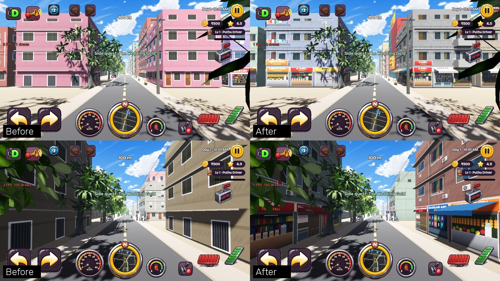
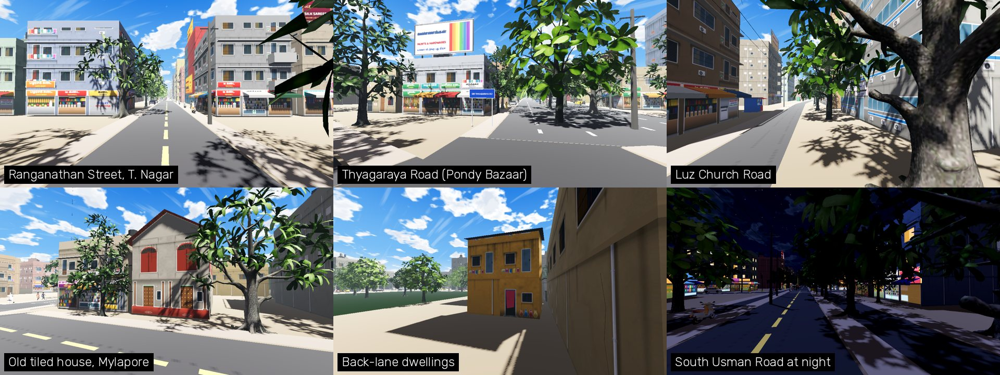

# Chennai buildings: types, street fronts and the facade atlas

Owner request (Nov 13): "Chennai is good but does not look like Chennai. Make the buildings
realistic so players know this is Chennai while playing. Don't compromise on performance."




## Why not Google Maps + Blender

The tutorial route (capture Google's photorealistic 3D tiles, clean them in Blender, import) was
checked and not used:

- **Licence.** Google's Map Tiles API policy forbids extracting geodata, offline use, and 3D
  objects "extracted, traced, or otherwise derived" from Photorealistic 3D Tiles. A Play Store
  game shipping those meshes would break the terms it was downloaded under.
- **Performance.** Photogrammetry is millions of triangles with a unique texture per block. Our
  budget is 150 draw calls and an 85 MB download on a Helio G85; one square kilometre of it
  would use the whole budget.
- **Look at street level.** Those meshes are captured from aircraft. From an auto's seat the
  walls are melted and the shop boards are unreadable, and shop boards are what says "Chennai".

What we do instead uses data we may ship: OpenStreetMap footprints, roads and places (ODbL),
Google Open Buildings heights (CC BY 4.0, already applied by `apply_building_heights.py`) and
our own painted art.

## How it works

1. **`tools/osm/classify_buildings.py`** (offline, runs last in a map rebuild) writes two keys
   into every building in `data/world/chunks`:
   - `"t"`, the building type, worked out from road class and name (bazaar streets), the zone,
     footprint size and shape, real height, the OSM kind and the OSM places inside the footprint;
   - `"fw"`, the walls that look onto a street with nothing in between, with the road's rank.
2. **`scripts/world/BuildingStyles.gd`** says how each type is skinned: atlas cells for the
   street front and for side walls, paint, roof, extras.
3. **`WorldChunkStreamer._typed_building`** builds it into the chunk's one building mesh. The
   street front is built bay by bay (shop per bay, balcony boxes, staircase jaali, showroom sign,
   rooftop hoarding). Walls that face no street are one quad per floor band.
4. **`tools/art/make_facade_atlas.py`** paints the 8 x 8 atlas (2048 px, 256 px per bay).

| Type | Count | What you see |
|---|---|---|
| `hs` independent house | 23,097 | portico with grille gate, grilled windows, terrace + Sintex tank |
| `fl` flats | 16,566 | stilt parking or gate, balconies with washing, staircase jaali |
| `sh` shop row | 7,820 | a shop per bay with Tamil-first boards, awnings, boards again on the first floor, some rooftop hoardings |
| `ah` old tiled house | 713 | thinnai veranda, red-oxide shutters, Mangalore-tile gable (Mylapore, Triplicane) |
| `sr` showroom | 638 | cladding and glass, mannequins or jewellery, a giant name board (T. Nagar, main roads) |
| `kp` small dwelling | 426 | bright paint, curtain in the doorway, water pots, sheet or thatch roof |
| `of` office | 274 | glass or strip windows |
| `ht` hotel / lodge | 198 | shop front below, AC windows above (name from BuildingBoards) |
| `tn` tenement | 152 | weather-beaten housing-board block |
| `hp` `gv` `bk` `sc` `tp` `ch` `mq` `cn` `ml` `sd` | 453 | hospital, government, bank, school, temple (kaavi + vimana), church (turret + cross), mosque (dome + minarets), cinema, mall, shed |

28,529 of 50,337 buildings have a street-facing wall.

## Performance (measured Nov 13)

| | Before | After |
|---|---|---|
| Draw calls, perf probe (max / p95) | 143 / 142 | 145 / 142 (budget 150) |
| Primitives in frame, perf probe (max) | 635,093 | 599,174 |
| Building-mesh vertices, 6 sampled chunks | 301,752 | 221,436 |
| Building materials / meshes per chunk | 1 / 1 | 1 / 1 |
| Atlas in GPU memory | 1024 x 512 RGBA8, no mips (2 MB) | 2048 x 2048 compressed + mips (about 5.6 MB) |

The old skin put sunshade ledges on every wall of every building. The new one spends triangles
only on walls the player can see from a road, so the city got cheaper while the streets got
busier. The atlas now has mipmaps; the shader caps the mip level (`MAX_TEXELS_PER_PIXEL`) so far
walls never blend neighbouring cells. These numbers are from the CI software renderer; frame
rate still has to be checked on the OnePlus tab and the Moto G40.

## Rules

- Every board is a generic trade ("மளிகை கடை / PROVISION STORE"), never a real business.
- The middle of cell (7, 0) must stay flat near-white plaster: every vertex-painted prop in the
  chunk mesh samples `PLAIN_UV` there.
- A whole cell on one quad uses `BuildingStyles.FULL_CELL`, never 0..1 (the shader takes
  `fract()`, so an exact 1.0 wraps to the other edge). Hoardings are painted 2 : 1 and squeezed
  into a square cell: put them on a 2 : 1 quad.
- Godot does not re-import a regenerated PNG when the game or a shot scene runs. After
  `make_facade_atlas.py`, run `godot --headless --path . --import` or you are looking at the old atlas.
- New building type: add it to `classify_buildings.py` `TYPES`, `BuildingStyles.TYPES`, a branch
  in `BuildingStyles.style()` and a palette; `tests/run_buildings_tests` checks all three agree.
- A chunk without `"t"` still draws with the older generic skin, so a half-finished map rebuild
  never breaks the game. `WorldChunkStreamer.typed_enabled = false` forces that skin.

## Checking it

```bash
python3 tools/art/make_facade_atlas.py && godot --headless --path . --import
godot --headless --path . --fixed-fps 60 res://tests/run_buildings_tests.tscn
SHOT_DIR=/tmp/shots SHOT_LIST="usman|-3061,2026,-3065,2.3,2056" \
  xvfb-run -a godot --path . --rendering-method gl_compatibility res://tests/shot_buildings.tscn
```
`SHOT_TYPED=0` renders the older skin, `SHOT_MIN=1215` night, `SHOT_TREES=0` hides the trees.

## Not done yet

- The ground between the road and the buildings is still bare sand in many places. Real Chennai
  plots run to the footpath behind a compound wall. This is now the biggest thing that makes a
  street look unlike Chennai.
- Individual buildings are typical for their street, not portraits of the real ones. Named
  landmarks are still the hand-built ones in `docs/CHENNAI_ARCHITECTURE_AUDIT.md`.
- OSM places are sparse (about 2,000 in the box), so most schools, clinics and banks are still
  drawn as homes or shops.
- Not yet seen on a phone: board legibility at 0.85 render scale, ASTC quality of the Tamil text,
  frame rate in T. Nagar.
