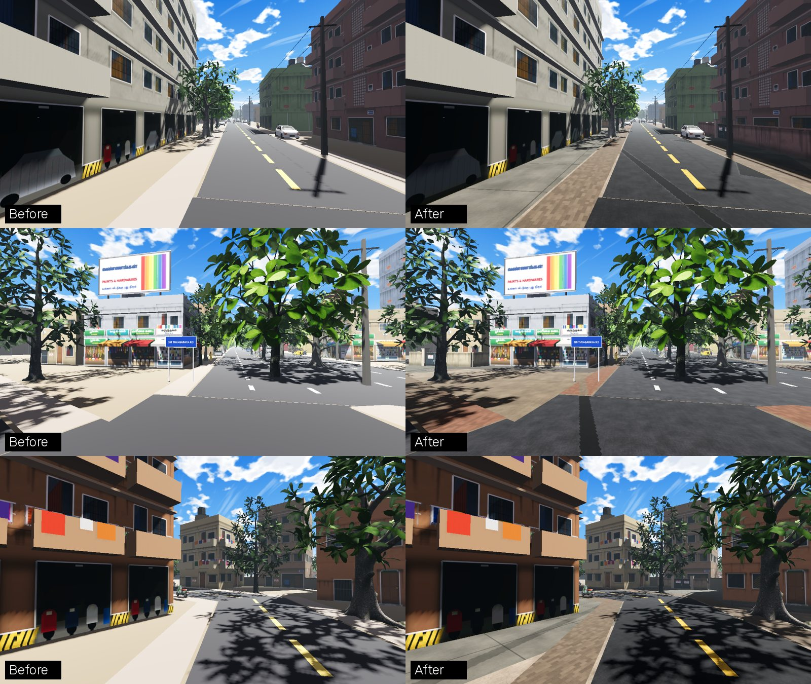
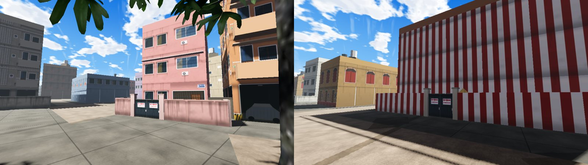

# Chennai streets: roads, paved plots, compound walls, ambience

Owner request (Nov 13): "Make the roads look like Chennai and realistic. Start on the compound
walls and the paved plots. Realistic textures for the roads and compounds. Add free ambient
sounds of Chennai."

## Roads and ground

Every road, footpath, paved plot and the open ground draw through one shader,
`shaders/street_surface.gdshader`. A surface keeps its vertex colour; the look comes from
`assets/textures/ground_detail.png` (`tools/art/make_ground_detail.py`), four tiling grey maps in
one 1024 px texture, sampled in world space:

| Channel | Map | Used for |
|---|---|---|
| R | asphalt: binder with aggregate and pits | roads, junctions, under worn paint |
| G | interlocking 20 x 10 cm pavers | footpaths, shop frontages |
| B | trowelled concrete with hairline cracks | cement forecourts, open ground |
| A | wear: soft blotches, repair patches, a trench scar | fading, patches, damp corners, red paver stretches |

What it adds: sun-bleached grey asphalt instead of flat black, darker repair patches and cable
trench scars, chipped lane paint, paver footpaths with stretches relaid in red blocks, cement
with expansion joints, packed earth in place of flat sand. The wear map is looked up a second
time, rotated, so a patch never repeats along a road.

Cost: two texture lookups per pixel (one on the Low graphics preset, `rich` off), no extra
draw calls, one extra 1024 px compressed texture (about 1.4 MB of GPU memory).

## Paved plots and compound walls

`tools/osm/build_plots.py` writes `data/world/plots/c_<i>_<j>.json` (515 files, 11.9 MB):

- **Paving** (271,928 triangles, about 530 a chunk): every footprint grown by an apron, plus the
  strip from each street-facing wall out to the real road surface. Shops, showrooms, hotels,
  banks and offices get pavers to the road. Flats, houses, schools, temples and the rest get
  cement. It is drawn just under the road layers, in the same mesh as the roads.
- **Compound walls** (42,424 runs, 182 km) for flats, houses, tenements, schools, government
  buildings, churches, the mosque and temples: parallel to the street front, at least 2.6 m
  behind the real road surface, with returns back to the building line.
- **Gates** (12,592): one per walled front, two piers and a pair of steel leaves.

Walls and gates go into the chunk's one building mesh and one collider, so they are solid for
the auto and for walkers and cost no draw calls. A wall takes its building's paint (same seed);
temple walls are kaavi, red and white stripes. The wall run, gate leaf and a "STICK NO BILLS"
panel with torn posters are painted in facade atlas cell (1, 1).

A wall is cut wherever something already stands: trees, poles, parked vehicles, stalls, carts,
transformers, bus stops, signs, signal posts, props, auto stands, service points, landmarks,
quest places, water, parks, other buildings, other walls. A building closer than 1.4 m to the
kerb strip gets no wall: there the building is the street edge.

## Ambience

`AmbienceAudio` keeps the traffic bed, sea, market and rain loops and adds:

| Sound | When |
|---|---|
| Crows (loop) | all day, louder away from the bazaars, silent at night and in rain |
| City birds (loop) | dawn until 8:30 am |
| Insects (loop) | after dark, away from the bazaars |
| Temple bell | every 14 to 34 s within 260 m of a temple (49 spots) |
| Church bell | every 50 to 110 s within 260 m of a church (7 spots) |
| Street dogs | at night, every 25 to 70 s |
| Cycle bell | by day, every 35 to 90 s |

All seven are CC0 from BigSoundBank, fetched by the Fetch Assets workflow (2.1 MB in all).
One-shots play from two pre-built voices. Temple and church positions come from the building
types (`data/world/sound_spots.json`, written by `classify_buildings.py`).

**These are stand-ins.** They are French field recordings: the crows are not Chennai house
crows, the temple bell is a hand bell, there is no koel, no vendor call, no pressure cooker.
Recordings made in Chennai under CC0 or CC BY would replace them file for file.

## Performance (measured Nov 13, CI software renderer)

| | Buildings PR | This change |
|---|---|---|
| Draw calls, perf probe (max / p95) | 145 / 142 | 145 / 142 (budget 150) |
| Primitives in frame (max) | 599,174 | 623,955 (635,093 before both) |
| Static memory | 206 MB | 208 MB |

Not measured: GPU frame time on a phone. The road shader went from no texture to two lookups
over most of the screen, so FPS on the Moto G40 is the number to watch. If it drops, the Low
preset already halves the lookups, and `WorldChunkStreamer.plots_enabled = false` removes the
walls and paving.

## Rebuild order

… every dressing pass → `classify_buildings.py` → `build_plots.py` (last). The OSM workflows
run both. A new kind of roadside object must be added to the keep-out list in `build_plots.py`.

## Not done yet

- Kerb stones (the black-and-yellow painted kerbs), speed breakers, manhole covers, zebra crossings.
- Gates are always shut; nothing drives in or out.
- Walls are one plaster style plus kaavi. No brick, grille-topped or stone walls yet.
- The textures are painted by code, not photographs. Photo textures (CC0, for example ambientCG)
  could replace the four detail maps through the same shader if these read as too clean on the device.
- Plot boundaries are inferred from the building and the road, not surveyed parcels.
