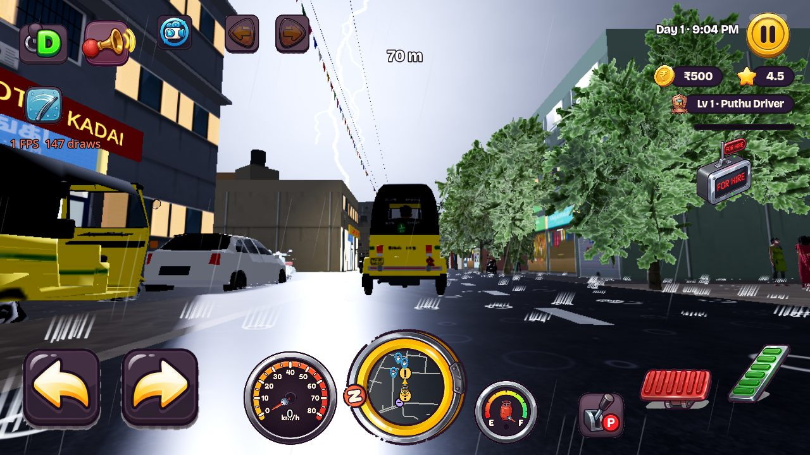

# Thunder and lightning (Nov 14)

Owner request: "The sounds must be realistic. The environment light must obey the light from the
lightning. The lightning must be realistic, with realistic sounds heard from low to high."

## When storms happen

* Rain is still decided once per in-game day (`GameState.roll_weather`): 40 % in October–January,
  12 % otherwise, for 2–5 game hours between 9 AM and 4 PM.
* A rainy day is a thunderstorm with 60 % chance in the Northeast Monsoon months and 80 % in the
  rest of the year (Chennai's summer and pre-monsoon showers are nearly always convective).
  `GameState.is_thunderstorm()` hashes the day, so it survives a save and load.
* The storm has a bearing and a closest approach (0.4–3.5 km) per day. It starts ~10 km away,
  passes closest in the middle of the rain and moves on (`storm_centre_m`). Strikes come every
  ~8 s at the peak and ~28 s at the edges (each ×0.6–1.4), 35 % of them to the ground.

## Everything follows the distance

| | close (~300 m) | mid (~2 km) | far (~8 km) |
|---|---|---|---|
| Flash on the street (`light_falloff`) | bright, from above | moderate | barely |
| Sky glow (`sky_falloff`) | whole deck | strong toward the strike | flicker on the horizon |
| Bolt | yes, with branches | yes, thin | none past 9 km |
| Thunder delay (d / 343 m/s) | ~1 s | ~6 s | ~23 s |
| Level (`thunder_db`) | about −1 dB | about −16 dB | about −24 dB |
| Low-pass (`thunder_cutoff_hz`) | 16 kHz: the crack | ~2.5 kHz | ~600 Hz: only the roll |
| Recording pool | close (real cracks) | mid (single booms) | far (long rolls) |
| Pan | hard to its side | | gentle |

## Light

A cloud-to-ground strike is a faint leader, then 1–4 return strokes 40–120 ms apart, each a sharp
peak that dies in ~70 ms: that is the flicker. A strike inside the cloud is 1–3 softer, slower
flashes with no bolt. While it flashes:

* one shadowless `DirectionalLight3D` shines from the strike (high when close, low when far), in a
  cool white;
* the Environment's ambient and fog light energies rise, so shaded sides and the rain-filled air
  light up too (Atmosphere keeps owning the colours);
* the sky shader's `flash` lights the cloud deck from inside, brightest toward the strike;
* the bolt (one mesh, rebuilt per strike) stands at the real angle on the horizon; buildings in
  front hide it.

All of it returns to the exact previous values after the last stroke. Cost: up to 2 draw calls for
about a third of a second, nothing between strikes.

## Sound

Real recordings only, sorted by `tools/assets/analyse_thunder.py` into `thunder.json`:

* **close**: Freesound field recordings of very close strikes with a real crack (InspectorJ,
  kevp888; CC BY 4.0);
* **mid**: single booms (BigSoundBank Thunder #2, #3, #4, #6, #7; TSP-Talk's Munich strike);
* **far**: long rolls (BigSoundBank Thunder #1, #5, #8–#11).

Each file starts where its thunder begins (the measured onset), so the sound lands exactly
d / 343 s after the flash. Three voices, each on its own bus with a low-pass, a panner and a short
city reverb; a new strike takes a free voice or the one that has played longest, so overlapping
rolls die off naturally.

## Checks

* `tests/run_streets_tests` `_test_thunderstorm`: no lightning when dry; a close strike lights the
  light, ambient, fog and sky and shows a bolt, then everything returns to normal; the thunder is
  still on its way after one second and arrives at d / 343 s from the close pool, loud, bright and
  panned to its side; a far cloud flash lights the sky more than the street with no bolt and
  rumbles quietly through a low-pass; storms strike by themselves; no nodes are created.
* `SHOT_STRIKE=900,-12 SHOT_PITCH=0.45 SHOT_MIN=1260` with `--fixed-fps 60` in
  `tests/shot_city.tscn` renders the frame before and the flash.
