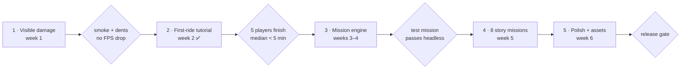

<!-- Source plan from the project Docs (26 Oct 2026), kept here so the roadmap in README.md can link to it. -->
> **Status (27 Oct 2026)** — README.md → Roadmap tracks progress; the plan's phases map to roadmap phases as follows.
>
> | This plan | Roadmap phase | Status |
> |---|---|---|
> | Phase 1 — Visible damage | Phase 6 | ⬜ next |
> | Phase 2 — First-ride tutorial | done before the plan's order (post-MVP) | ✅ code (PR #10); voice, portrait and play-test gate open |
> | Phase 3 — Mission engine | Phase 7 | ⬜ |
> | Phase 4 — 8 story missions | Phase 8 | ⬜ |
> | Phase 5 — Polish, assets, release gate | Phase 9 | ⬜ |
>
> **Recommended design (27 Oct 2026, to confirm before Phase 7 starts)**
> * Missions are part of **Career**, not a separate mode: one save, one wallet; hails pause while a mission runs.
> * A mission **sets its own time of day and weather** while it runs (the shift clock pauses and is restored afterwards), so every mission can start at any time and replays for stars are quick.
> * The first cut ships the **Missions board on the home screen**; the in-world stand board starts as a marker and gets its chalkboard model with the art pass.
> * Test-suite numbers: suites 10 and 11 already exist (play-test round 2, tutorial), so damage uses `run_phase12_tests`, the mission engine `run_phase13_tests` and the launch missions `run_phase14_tests`.

# Namma Auto — Missions, Tutorial & Damage Plan

Oct 26, 2026 · David Raj Paul

Three features land in five phases over about 6 weeks: visible damage first (it's small and feeds the other two), then the first-ride tutorial, then a mission engine and 8 Chennai story missions. Each phase ships behind green tests, like Phases 1–9.

## At a glance

Each diamond is a gate: the next phase starts only when its check passes.

## Phase 1 — Visible damage on the auto (week 1)

Every hit leaves a mark you can see and fix: smoke grows with damage, panels dent where you hit, and the garage repair puts it all back. It builds on what exists today — `GameState.condition` (0–100), `SignalBus.player_impact` with severity and contact point, and `CollisionFX` sparks.

**Damage states** (driven by `condition`, saved already):

| Condition | What the player sees | Gameplay effect |
| --- | --- | --- |
| 100–75 | Clean, small scratches decal | None |
| 75–50 | Thin grey smoke puffs from the engine at idle, one dented panel | None |
| 50–25 | Steady grey smoke, rattling sound, 2–3 dents, cracked headlamp | Top speed −10 % |
| 25–1 | Thick dark smoke + occasional backfire flash, bumper hanging | Top speed −20 %, random stall on hard hit |
| 0 | Black smoke, engine dies | Must tow or watch rewarded ad for roadside fix |

**Build tasks**

1. `scripts/vehicle/DamageVisuals.gd` (new, child of the auto): listens to `condition_changed` and `player_impact`; owns the smoke emitter, dent state and the stage logic above.
2. **Smoke**: one `GPUParticles3D` (CPU fallback on the compatibility renderer) at the engine under the rear seat; soft billboard puff texture; amount, colour (white → grey → black), size and lifetime lerp with damage; puffs grow while the auto idles and stretch backwards with speed. Budget ≤ 40 particles, 1 draw call.
3. **Impact puff**: a short burst of dust/smoke at the contact point on every hit with severity ≥ 0.3 (reuses the spark position from `CollisionFX`).
4. **Dents**: 6 hit zones on the body (front nose, left/right front, left/right rear, back). The impact point picks the nearest zone; that zone's vertices are pushed in a few cm by a vertex-shader dent map (no mesh rebuild) and get a scratch decal. Zone damage is saved with the profile.
5. **Loose parts**: below 25 % the bumper tilts and the headlamp flickers (cheap transform + light energy changes).
6. **Audio**: engine loop pitch wobble and a rattle layer below 50 %; backfire pop below 25 %.
7. **HUD**: small spanner icon with the condition % next to the fuel gauge; pulses red below 25 %; tap → "Nearest garage" on the full map.
8. **Repair**: garage repair clears smoke and dents over a 1 s "fixed" animation; partial repairs clear the worst zones first.
9. **Passenger reaction**: riders cough or comment ("Anna, vandi pogumaa?") when boarding a smoking auto; comfort tip −20 % below 50 %.

**Tests** (`tests/run_phase10_tests.gd`): each condition band switches smoke stage; impact on the left side dents a left zone; repair clears all; damage survives save/load; draw calls stay ≤ 150 with smoke on.

**Gate**: smoke and dents visible in chase and cockpit views on a budget phone with no FPS drop.

## Phase 2 — First-ride tutorial (week 2)

A new player finishes one real, scripted ride in about 4 minutes, guided by Murugan Anna, a senior driver at the Mylapore stand. It replaces today's three text hints (`ComfortAssist` `tutorial_step`) with a step machine that waits for the player to actually do each thing.

**Script** (each step: a Tamil/English voice line + subtitle, a highlighted control, and the condition that completes it):

1. **Start the engine** — "Vaa thambi! First, kick-start pannu." Highlight the kick button; done when the engine runs.
2. **Pull out** — hold ACCEL, follow the blue line to the corner; done at 15 km/h.
3. **Steer and brake** — a gentle turn and a stop at a painted line; done when stopped within 3 m.
4. **Indicate** — signal left before the next turn; done on `signalled_turn`.
5. **Horn** — a scooter blocks the lane; honk to clear it.
6. **Pick up** — a waiting passenger (scripted, always the IT commuter); stop beside her.
7. **Haggle** — the card opens; Anna explains the three offers; this ride always accepts "Correct Meter".
8. **Follow the GPS** — a fixed 600 m route through Mylapore with the turn banner; tea cup meter explained.
9. **Drop off** — stop inside the green ring; fare card explained; +₹100 "first savari" bonus.
10. **Free roam** — "Ippo nee thaan boss." Map, garage and goals pointed out once.

**Build tasks**

1. `scripts/tutorial/TutorialDirector.gd`: step list as data (`data/tutorial/first_ride.tres`), each step = {line key, voice file, highlight control id, completion signal + params, timeout hint}.
2. **Spotlight overlay** on the TouchHUD: darken the screen except the control to press, pulsing ring + finger icon.
3. **Scripted world**: during the tutorial, traffic density forced low, no interstitials, fixed passenger and destination, no fuel burn, collisions can't drop condition below 80.
4. **Mentor**: portrait card (bottom-left) with subtitles; voice lines recorded in Tamil + English (≈ 20 lines, ≤ 6 s each).
5. **Skip and resume**: "Skip tutorial" in the pause menu; quitting mid-way resumes at the last finished step; a "Replay tutorial" option in Settings.
6. **Analytics hooks**: emit `tutorial_step_completed(step, seconds)` so drop-off per step can be measured later (Firebase).

**Tests** (`tests/run_phase11_tests.gd`): a headless bot plays every step via Input actions and reaches free roam; skip works; resume after reload starts at the saved step; no interstitial can fire while the tutorial runs.

**Gate**: 5 first-time players finish it without help; median time under 5 minutes.

## Phase 3 — Mission engine (weeks 3–4)

Missions are data, not code: a designer writes a `.tres` file of stages, and one `MissionDirector` runs any of them on top of the normal savari loop. The tutorial from Phase 2 is converted to the first mission to prove the engine.

**Data model** (`data/missions/MissionDef.gd`):

| Field | Example |
| --- | --- |
| id, title (EN/TA), blurb, portrait | `hospital_rush`, "Pregnancy Emergency" |
| unlock | driver level 3, or after mission X |
| start | stand id or map marker, time-of-day window, weather |
| stages\[\] | ordered list of stage resources (below) |
| rewards | ₹, XP, respect, cosmetic id, achievement id |
| fail rules | timer, max condition loss, max comfort loss, passenger angry |

**Stage types** (each a small script implementing `enter / tick / is_done / is_failed`):

- `GoTo` — drive to a place (named OSM landmark or street) within a time; uses `GpsRoute` + `NavBanner`.
- `PickUp` / `DropOff` — scripted passenger(s) with luggage and party size.
- `Dialogue` — lines with optional 2–3 choices that set mission flags.
- `Constraint` — for the stage: keep comfort ≥ X, no hits above Y m/s, stay under 30 km/h, no horn.
- `Chase` / `Follow` — follow or catch a scripted AI vehicle on the road graph.
- `Event` — trigger world changes: road block, rain, traffic surge, flood spot active.
- `Wait` — park and wait N seconds (temple darshan, shopping).

**Build tasks**

1. `scripts/missions/MissionDirector.gd` (scene node) + `MissionState` saved in `GameState` (active mission, stage, flags, best times, stars).
2. **Mission board**: a chalkboard at every auto stand and a "Missions" tab on the home screen; locked, available, completed with 1–3 stars.
3. **Start flow**: drive into the stand marker → briefing card (title, portrait, reward, "Start") → the normal hail loop pauses while a mission runs.
4. **Mission HUD**: objective line under the nav banner, stage timer, constraint meters reuse the tea-cup bar.
5. **Outcome screen**: stars from time, comfort and damage; ₹ and XP through `GameState.grant_reward("mission", …, id)` so a mission pays once per star level (idempotent ledger already built).
6. **Fail and retry**: retry from the last checkpoint stage; one free retry, extra retry via rewarded ad (opt-in).
7. **Damage tie-in**: missions can require condition ≥ 50 at start; smoke from Phase 1 makes the auto visibly unfit.

**Tests** (`tests/run_phase12_tests.gd`): a test mission with every stage type runs headless to success and to each fail rule; rewards pay once; mission state survives save/load mid-mission; the tutorial runs as a mission.

## Phase 4 — Launch set: 8 Chennai story missions (week 5)

Eight 3–6 minute missions, each built only from the Phase 3 stage types, unlocking across driver levels 1–8 so a new player always has the next one in sight.

| # | Mission | Unlock | Story and challenge | Key stages |
| --- | --- | --- | --- | --- |
| 1 | Muthal Savari | Start | The tutorial ride (Phase 2) | GoTo, PickUp, Dialogue, DropOff |
| 2 | Office Rush | Lv 2 | IT commuter late for a 9 AM meeting at Anna Salai; peak traffic | Event (surge), GoTo with timer |
| 3 | Pregnancy Emergency | Lv 3 | Woman in labour from Mylapore to a hospital; tea cup must stay above 70 % | Constraint (comfort, no hits), timer |
| 4 | Lost Tourist | Lv 4 | Foreign tourist sees Kapaleeshwarar, Marina Lighthouse, Santhome; choose the honest fare or overcharge | Wait × 3, Dialogue choice |
| 5 | Kalyanam Party | Lv 5 | Wedding family + 60 kg luggage to a T. Nagar mandapam before the muhurtham | PickUp (heavy), Constraint (no tilt), timer |
| 6 | Monsoon Rescue | Lv 6 | Rain floods Usman Road; ferry 3 stranded people avoiding deep water | Event (rain + floods), PickUp × 3 |
| 7 | Follow That Auto! | Lv 7 | A passenger spots the thief who took her bag; tail him through Triplicane without being seen | Follow (keep 20–60 m) |
| 8 | Night at the Marina | Lv 8 | Late-night ride for a nervous student; drive calmly, no horn, under 40 km/h | Constraint (speed, horn), night |

**Per-mission work**: `.tres` data, 6–12 voice lines (Tamil + English subtitles), portrait art, one tuned difficulty pass, 1/2/3-star thresholds, and a test that plays it headless.

**Content pipeline**: a short writing template (goal, twist, line list, reward) so new missions after launch take about a day each; ship 2 new ones a month as a retention update.

## Phase 5 — Polish, assets and release gate (week 6)

The last week turns working features into shippable ones and checks them on real phones.

- [ ] Record voice lines: ≈ 20 tutorial + ≈ 70 mission lines, Tamil and English (a local voice artist or a licensed TTS voice)
- [ ] Assets: smoke puff and scratch decal textures (can be made in-house), 8 mission portraits, mentor portrait, mission board model
- [ ] Balance: star thresholds and rewards from 10 play-test runs per mission; no mission harder than 60 % first-try success
- [ ] Performance: smoke + mission HUD inside 150 draw calls; 30-minute soak on a 4 GB RAM phone
- [ ] Localisation: every new string in `translations/ui.csv` (EN + TA)
- [ ] Analytics: tutorial step drop-off, mission starts / fails / retries
- [ ] Store: new screenshots of smoke and missions, "Story missions" in the listing

**Release gate**: all suites green in CI, AAB built, tutorial median under 5 minutes, every mission finished by at least 3 play-testers.

## Risks and open questions

| Risk | Fallback |
| --- | --- |
| Smoke particles cost too much on the compatibility renderer | CPU particles with ≤ 20 puffs, or a scrolling smoke sprite card |
| Vertex dents look wrong on the imported GLB auto | Decal-only damage (scratches, cracks) and swapped damaged-panel meshes |
| Voice recording slips | Ship with subtitles + short Tamil grunt/exclamation SFX, add voices in an update |
| Missions feel repetitive | Keep each under 6 minutes, give every one a unique twist or stage type |

- [ ] Who records the Tamil voice lines — a voice artist, a friend, or TTS?
- [ ] Should damage ever stop the auto mid-ride (risky for frustration), or only slow it?
- [ ] Order of work: damage → tutorial → missions as planned, or tutorial first for the next store build?

